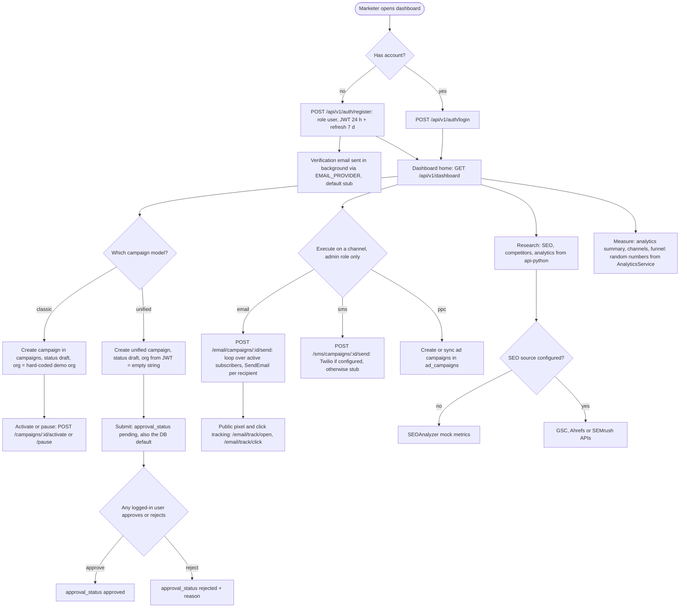
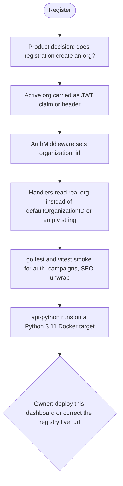

# 01 — Business process (As-Is / To-Be)

BookMarketing (repo `marketing-campaign-platform`) คือ dashboard รวมงาน marketing สำหรับทีมเล็กหรือ solopreneur (`PRODUCT.md` §Who this is for)
ณ `origin/main` `a4061e5` ยัง **ไม่มี deployment** ใดเลย (`specs/001-next16-ci-sentry/spec.md` §5) ภาพ As-Is จึงเป็น process ที่โค้ดรองรับเมื่อรันในเครื่อง (`npm run dev` / `docker/docker-compose.yml`) ไม่ใช่การใช้งานจริงของลูกค้า

## As-Is — campaign lifecycle ที่โค้ดรองรับวันนี้

Sources: `api-go/internal/delivery/http/router.go`, `api-go/internal/delivery/http/auth_handler.go`, `api-go/internal/application/service/auth_service.go`, `api-go/internal/delivery/http/campaign_handler.go` (`defaultOrganizationID`), `api-go/internal/delivery/http/unified_campaign_handler.go`, `api-go/internal/infrastructure/repository/unified_campaign_repository.go`, `api-go/internal/application/service/email_campaign_service.go`, `api-go/internal/application/service/sms_service.go`, `api-go/internal/application/service/email_factory.go`, `api-python/app/api/seo.py`, `api-python/app/services/seo_data_sources.py`, `api-python/app/services/analytics_service.py`, `PRODUCT.md`

ข้อสังเกตจากโค้ด

- Classic campaigns ใช้ org คงที่ `00000000-0000-0000-0000-000000000001` (`defaultOrganizationID`) unified campaigns อ่าน `c.GetString("organization_id")` ซึ่ง `AuthMiddleware` ไม่เคย set: ได้ `""` เสมอ; SMS / social (`sms_handler.go`, `social_handler.go`) แทนค่าว่างด้วย demo org และ approval (`approval_handler.go`) ใช้ `defaultOrganizationID` ตรง ๆ จึงไม่ fail แต่ข้อมูลทุกคนปนอยู่ใน demo org เดียว (`PRODUCT.md` §Trust boundaries ระบุเป็น documented limitation)
- Approve/reject unified campaign ไม่มี role check: user ที่ login แล้วทุกคนเรียกได้ (`router.go` group `unified` ไม่มี `AdminOnlyMiddleware`)
- Approval workflow แยก (`/approval/requests/:id/respond`) ตัดสินผลตาม `approval_order` `any` / `sequential` / `parallel` (`approval_service.go`) แต่ไม่ผูกกับ `unified-campaigns/:id/submit` (สอง flow ไม่เรียกกัน)
- ตัวเลข analytics ทั้งหมดใน `analytics_service.py` มาจาก `random` ไม่ได้อ่าน DB

## To-Be

แหล่ง To-Be ที่มีใน repo: `PRODUCT.md` §Next improvements และ `specs/` (SPEC-001 ทำเสร็จแล้ว ไม่มี spec ใหม่) ไม่มี `docs/UPGRADE-PLAN.md` และ GitHub issues

Sources: `PRODUCT.md` §Next improvements, §Trust boundaries, `specs/001-next16-ci-sentry/spec.md` §5 Known gaps

## Open questions

- To-Be ของ campaign process ทั้งเส้น (ใครอนุมัติ, ใช้ classic หรือ unified เป็นหลัก, จะรวม approval workflow เข้ากับ unified submit หรือไม่) ไม่มีเอกสาร: ต้องให้ owner ตัดสิน
- จะ deploy dashboard นี้หรือไม่ (`bookmarketing.bookchaowalit.com` ไม่ resolve; `marketing.bookchaowalit.com` เป็นของ repo `marketing-bookmarketing-web`)
- Classic `campaigns` กับ `unified_campaignes` จะเก็บไว้ทั้งคู่หรือรวมเป็นอันเดียว
