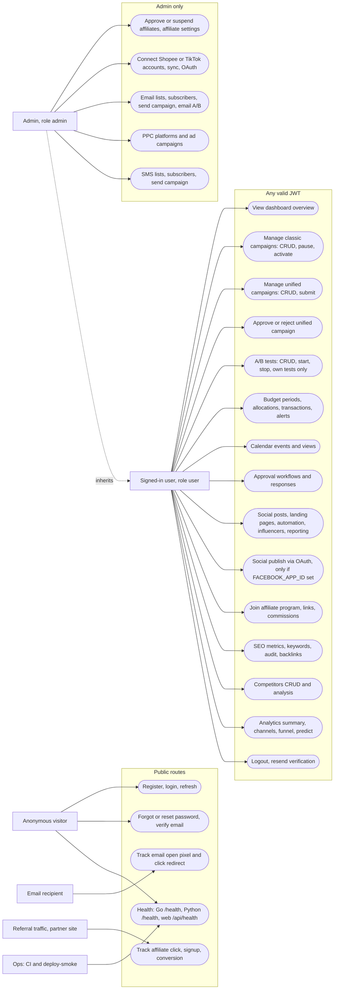

# 02 — Use cases

Actors มาจาก auth level ที่โค้ดบังคับจริง: route สาธารณะ, `AuthMiddleware` (JWT ใดก็ได้), `AdminOnlyMiddleware` (`role == "admin"`) ใน `api-go` และ `get_current_user_id` (JWT ใดก็ได้) ใน `api-python`
`register` สร้าง `role: "user"` เสมอ (`auth_service.go`); admin มีเฉพาะ seed `admin@marketing.com` ใน `api-go/migrations/001_init.up.sql`
ตาราง `organization_members.role` (`owner/admin/member/viewer`) มีใน schema แต่ไม่มีโค้ดใดอ่าน

Sources: `api-go/internal/delivery/http/router.go`, `api-go/internal/delivery/http/middleware.go`, `api-go/internal/application/service/auth_service.go` (`Role: "user"`), `api-go/migrations/001_init.up.sql` (admin seed), `api-go/migrations/005_organizations.up.sql` (`organization_members`), `api-python/app/main.py`, `api-python/app/core/auth.py`, `web/src/app/api/health/route.ts`, `.github/workflows/deploy-smoke.yml`

ข้อสังเกต

- `require_admin` ใน `api-python/app/core/auth.py` ถูกประกาศแต่ไม่มี route ใดใช้
- หน้า web `/email-campaigns`, `/sms`, `/ppc`, `/integrations` เรียก endpoint admin-only: user ปกติได้ 403
- `UC19` ถูก register เฉพาะเมื่อมี `FACEBOOK_APP_ID` และ `FACEBOOK_APP_SECRET` (`router.go`)

## Open questions

- Role model ที่ต้องการ: ใช้ `users.role` (`user/admin`) ต่อไป หรือย้ายไป `organization_members.role`
- การ approve unified campaign ควรจำกัดเฉพาะ admin หรือ approver ใน `approval_workflows` หรือไม่
