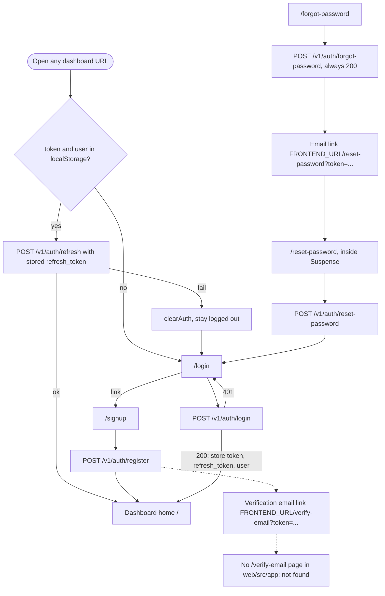
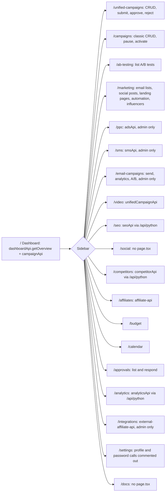
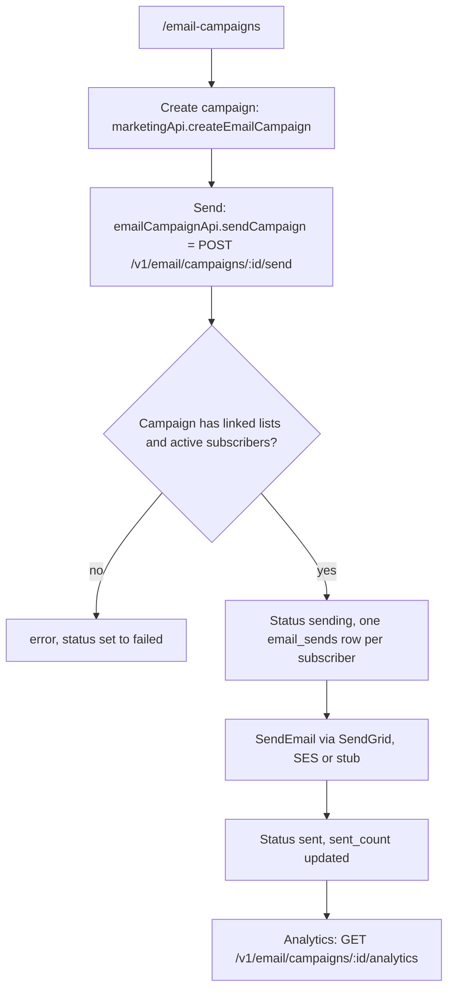

# 03 — User flows

Flow มาจาก App Router pages ใน `web/src/app/`, nav ใน `web/src/components/Sidebar.tsx`, auth state ใน `web/src/hooks/useAuth.tsx` และ API client ใน `web/src/lib/*.ts`
ทุกหน้าใต้ `(dashboard)` ถูกครอบด้วย `web/src/app/(dashboard)/layout.tsx`: ถ้า `useAuth()` ไม่มี `user` จะ `router.push('/login')` (guard ฝั่ง client เท่านั้น ไม่มี `middleware.ts`)

## Flow A — Visitor: sign up, login, password reset

Sources: `web/src/app/(dashboard)/layout.tsx`, `web/src/hooks/useAuth.tsx`, `web/src/app/login/page.tsx`, `web/src/app/signup/page.tsx`, `web/src/app/forgot-password/page.tsx`, `web/src/app/reset-password/page.tsx`, `web/src/app/not-found.tsx`, `web/src/lib/api-client.ts` (`authApi`, 401 interceptor), `api-go/internal/application/service/auth_service.go` (`resetURL`, `verificationURL`)

## Flow B — Signed-in user: navigate the dashboard

Sources: `web/src/components/Sidebar.tsx`, `web/src/app/(dashboard)/*/page.tsx`, `web/src/lib/api-client.ts`, `web/src/lib/affiliate-api.ts`, `web/src/lib/external-affiliate-api.ts`, `web/src/lib/marketing-features-api.ts`, `api-go/internal/delivery/http/router.go` (admin groups)

## Flow C — Admin: send an email campaign

Sources: `web/src/app/(dashboard)/email-campaigns/page.tsx`, `web/src/lib/api-client.ts` (`emailCampaignApi`), `api-go/internal/application/service/email_campaign_service.go`

## ข้อสังเกตที่กระทบ flow (จากการอ่านโค้ด ยังไม่ได้รันยืนยัน)

- `web/src/lib/affiliate-api.ts`, `external-affiliate-api.ts`, `marketing-features-api.ts` import `apiGo` (baseURL `/api/go`) แล้วต่อ path `/api/v1/...` ได้ `/api/go/api/v1/...` ซึ่ง rewrite ใน `web/next.config.ts` เป็น `<go>/api/api/v1/...`: ไม่มี route นี้ใน `router.go` ส่วน `api-client.ts` ใช้ `/v1/...` ถูกต้อง หน้า `/affiliates`, `/integrations`, `/marketing` และบางส่วนของ `/email-campaigns` จึงน่าจะได้ 404
- `email-campaigns/page.tsx` มี `fetch('/api/go/v1/email/ab-tests')` และ fallback เป็น `defaultABTests` เมื่อ error: หน้าจะแสดงข้อมูลตัวอย่างแทน error
- Sidebar มีลิงก์ `/social` และ `/docs` ที่ไม่มี `page.tsx`
- `web/public/index.html`, `app.html`, `dashboard.html` (title "MarketPro") เป็นหน้า static รุ่นเก่า เสิร์ฟที่ `/index.html` ฯลฯ ไม่ได้เชื่อมกับ App Router

## Open questions

- ต้องการหน้า `/verify-email` หรือให้ลิงก์ verify ชี้ไปที่อื่น
- `/social` และ `/docs` ควรมีหน้าหรือเอาออกจาก Sidebar
- ไฟล์ static ใน `web/public/*.html` ยังต้องใช้หรือไม่
