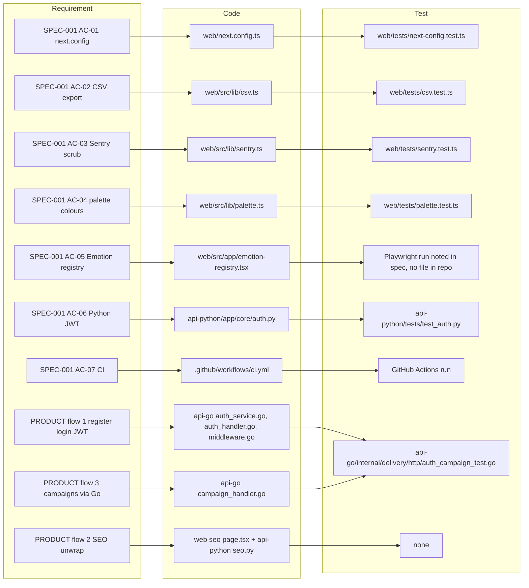

# 04 — Traceability (RTM)

Requirement มีสองแหล่งใน repo: `specs/001-next16-ci-sentry/spec.md` (AC-01..AC-07, status implemented) และ `PRODUCT.md` (Main user flows + Next improvements)
Release = commit บน `main` ที่ CI (`.github/workflows/ci.yml`) เขียว ไม่มี deployment หรือ tag (ดู 18, 22)

Sources: `specs/001-next16-ci-sentry/spec.md` §3, `PRODUCT.md` §Main user flows, `web/tests/*.test.ts`, `api-python/tests/test_auth.py`, `api-go/internal/delivery/http/auth_campaign_test.go`, `.github/workflows/ci.yml`, `git log`

| Req | Code | Test | Release (commit on `main`, CI) |
|---|---|---|---|
| AC-01 no webpack hook, no ignoreBuildErrors, `/api/go/*` `/api/python/*` proxied | `web/next.config.ts` | `web/tests/next-config.test.ts` | `1ee7d36` (red) → `c7e232c`; CI green from `c796b31` |
| AC-02 CSV quoting + injection guard | `web/src/lib/csv.ts`, `web/src/lib/export.ts` | `web/tests/csv.test.ts` | `1ee7d36` → `c7e232c` |
| AC-03 Sentry off without DSN, errors only, scrubbed | `web/src/lib/sentry.ts`, `web/src/instrumentation*.ts` | `web/tests/sentry.test.ts` | `c7e232c`, extended `34a136f` → `e182e01` |
| AC-04 theme colours resolved | `web/src/lib/palette.ts` | `web/tests/palette.test.ts` | `c7e232c` |
| AC-05 no hydration error #418 | `web/src/app/emotion-registry.tsx` | Playwright 24 loads (บันทึกใน spec, ไม่มีไฟล์ test ใน repo) | `c7e232c` |
| AC-06 HS256 only, PyJWT | `api-python/app/core/auth.py` | `api-python/tests/test_auth.py` (7 cases: 6 functions, one parametrized HS384/HS512) | `76f10ed` |
| AC-07 CI web, python, go, security @ `87dc5e1` | `.github/workflows/ci.yml` | CI run `39648565066` success | `1095ae3` (fail) → `c796b31` |
| ไม่มีใน spec: no demo credentials on login UI | `web/src/app/login/page.tsx` | `web/tests/no-demo-credentials.test.ts` | `92e0cf8` |
| ไม่มีใน spec: build marker for deploy smoke | `web/src/app/api/health/route.ts`, `scripts/deploy-smoke.sh` | `web/tests/health.test.ts` | `8e1d0f7`, `60379ea` (ยังไม่เคยรันจริง) |
| PRODUCT flow 1 register → JWT → authenticated request | `auth_service.go`, `auth_handler.go`, `middleware.go` | `auth_campaign_test.go` (7 top-level tests) | `8937ac2` |
| PRODUCT flow 2 SEO response unwrap | `web/src/app/(dashboard)/seo/page.tsx`, `api-python/app/api/seo.py` | **gap**: ไม่มี test | `ddd9fb8` |
| PRODUCT flow 3 campaigns / affiliates / email / social via Go | handlers ใน `api-go/internal/delivery/http/` | campaign create เท่านั้น; affiliates/email/social **gap** | `b934a69` |
| PRODUCT Next improvement 1: org in JWT | — | — | ยังไม่ทำ |

## Open questions

- AC-05 ควรมี Playwright test ถาวรใน repo หรือไม่ (ตอนนี้เป็นหลักฐานใน spec เท่านั้น)
- ต้องการ spec ใหม่สำหรับ multi-tenant org (PRODUCT Next improvement 1) ก่อนแก้โค้ดหรือไม่
