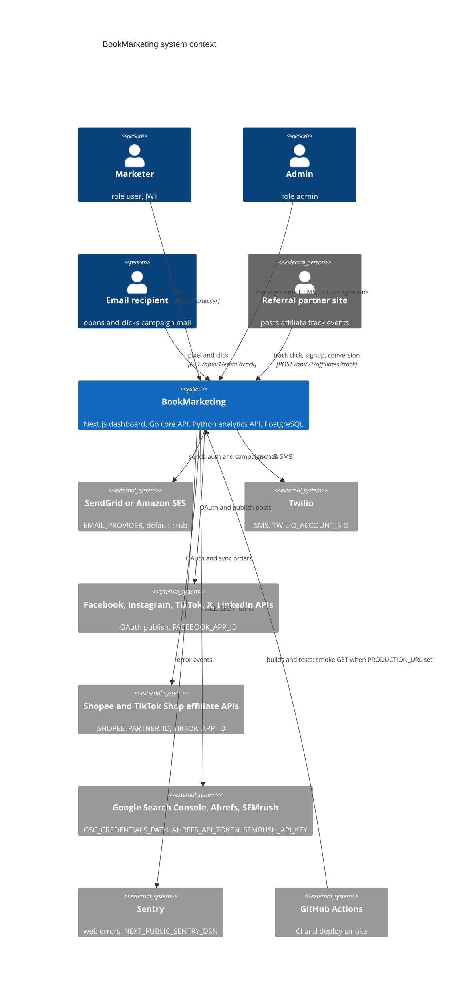

# 05 — C4 Context

ระบบเดียว (BookMarketing dashboard + APIs) ยังไม่มี host จริง ภาพนี้คือ context ตามโค้ด: external systems จะถูกเรียกก็ต่อเมื่อมี env var ของ provider นั้น (ไม่มี = ปิดหรือ stub)

Sources: `api-go/internal/delivery/http/router.go` (env gates), `api-go/internal/application/service/email_factory.go`, `twilio_service.go`, `facebook_client.go`, `instagram_client.go`, `tiktok_client.go`, `twitter_client.go`, `linkedin_client.go`, `shopee_integration.go`, `tiktok_integration.go`, `api-python/app/services/seo_data_sources.py`, `web/src/lib/sentry.ts`, `.github/workflows/ci.yml`, `.github/workflows/deploy-smoke.yml`

หมายเหตุ: Instagram ใช้ `graph.facebook.com` ผ่าน Facebook app เดียวกัน; TikTok มีสอง client (`tiktok_client.go` สำหรับ publish, `tiktok_integration.go` สำหรับ affiliate)

## Open questions

- Provider ใดที่ owner ตั้งใจเปิดจริงเมื่อ deploy (ตอนนี้ไม่มี env ใดถูกตั้ง เพราะไม่มี environment)
- Partner site ที่จะเรียก `/affiliates/track/*` คือใคร: endpoint เปิดสาธารณะไม่มี auth หรือ signature
