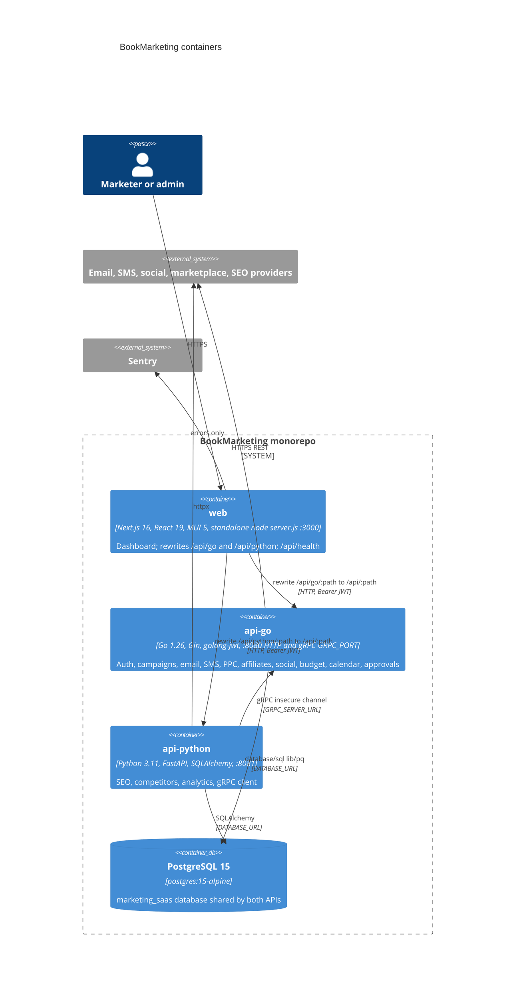

# 06 — C4 Container

Container ตาม `docker/docker-compose.yml` และ Dockerfile ของแต่ละ service (ยังไม่มี hosting จริง ดู 16)

Sources: `docker/docker-compose.yml`, `web/Dockerfile`, `api-go/Dockerfile`, `api-python/Dockerfile`, `web/next.config.ts`, `web/src/lib/api-client.ts`, `api-go/cmd/main.go`, `api-go/internal/infrastructure/database/postgres.go`, `api-python/app/core/database.py`, `api-python/app/core/config.py`, `api-python/app/api/grpc_client.py`, `web/package.json`, `api-go/go.mod`

ข้อสังเกต (จาก config ไม่ได้รัน)

- Port gRPC ไม่ตรงกัน: compose ตั้ง `api-go` `GRPC_PORT: 9091` แต่ `api-python` `GRPC_SERVER_URL: api-go:9090`; default ในโค้ด Go คือ `9090` ส่วน Python คือ `localhost:9091`
- `api-python/app/api/grpc_client.py` import `app.grpc_client.campaign_pb2` ที่ไม่อยู่ใน Git (`.gitignore` ตัด `*_pb2.py`) และ `packages/grpc-protos/Makefile` generate ไปที่ `app/grpc/marketing_pb2.py` ซึ่งเป็นคนละชื่อ: `app.main` import ไม่ผ่านจาก checkout (SPEC-001 §5)
- `packages/shared` (`@bookmarketing/shared-types`) เป็น TypeScript types ที่ web ใช้ผ่าน `tsconfig.json` paths ไม่ใช่ container

## Open questions

- gRPC port ที่ถูกต้องคือ 9090 หรือ 9091
- Python service จะ generate gRPC stubs ตอน build Docker หรือ commit ไว้
