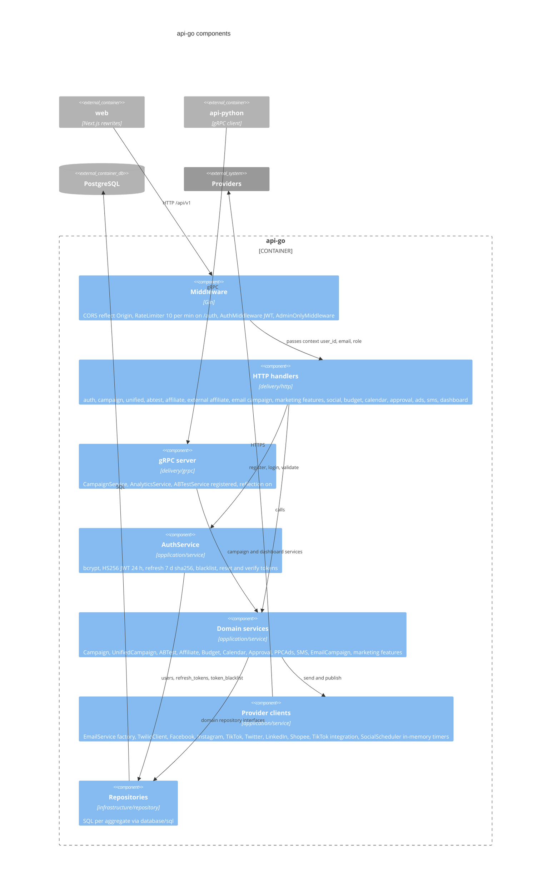
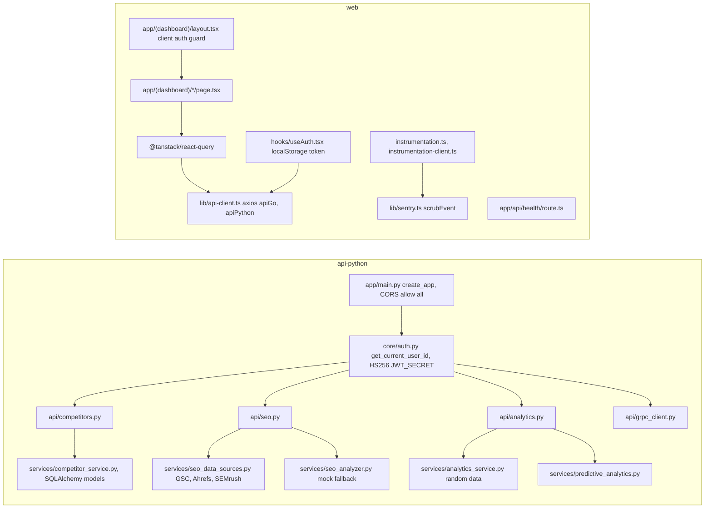

# 07 — C4 Component (api-go)

`api-go` ใช้ hexagonal layout: `delivery` (HTTP Gin + gRPC) → `application/service` → `domain` (entities + repository interfaces) ← `infrastructure/repository` (SQL) ทุกอย่างถูกประกอบใน `NewRouter(db)` (`router.go`) ไม่มี DI container

Sources: `api-go/cmd/main.go`, `api-go/internal/delivery/http/router.go`, `middleware.go`, `rate_limiter.go`, `api-go/internal/delivery/grpc/server.go`, `api-go/internal/application/service/*.go`, `api-go/internal/domain/repository.go`, `api-go/internal/infrastructure/repository/*.go`

หมายเหตุ

- บาง service (`EmailMarketingService`, `SocialMediaService`, `EmailCampaignService`, `SocialPublishService`) รับ `*sql.DB` ตรง ๆ แทน repository interface
- `main.go` สร้าง `CampaignService` และ `DashboardService` ชุดที่สองสำหรับ gRPC แยกจากชุดใน `NewRouter`
- gRPC `ABTestService` ถูก register แต่ `GRPCServer` embed แค่ `UnimplementedABTestServiceServer`: ทุก RPC ตอบ `Unimplemented`

## Component ของ api-python และ web (ย่อ)

Sources: `api-python/app/main.py`, `api-python/app/core/auth.py`, `api-python/app/api/*.py`, `api-python/app/services/*.py`, `web/src/app/(dashboard)/layout.tsx`, `web/src/hooks/useAuth.tsx`, `web/src/lib/api-client.ts`, `web/src/lib/sentry.ts`, `web/src/instrumentation.ts`, `web/src/instrumentation-client.ts`, `web/src/app/api/health/route.ts`

## Open questions

- ต้องการให้ gRPC `ABTestService` และ `CompetitorService` (มีใน proto แต่ Go ไม่ register CompetitorService) ทำงานจริงหรือเอาออกจาก proto
