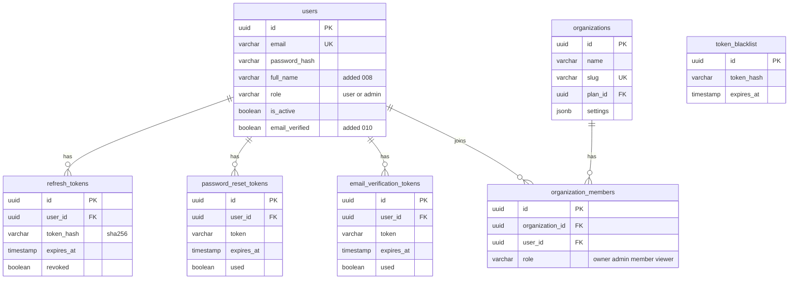
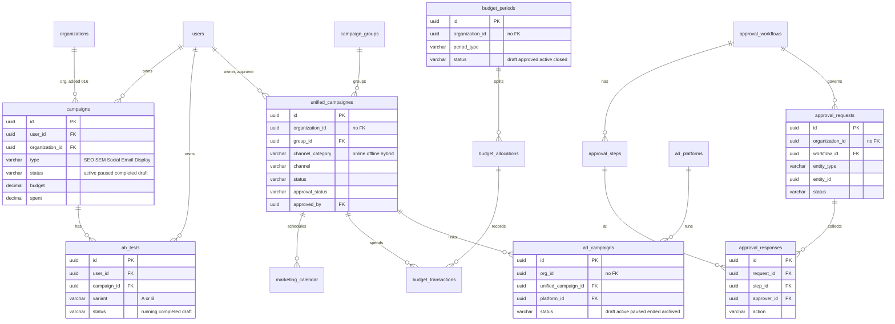
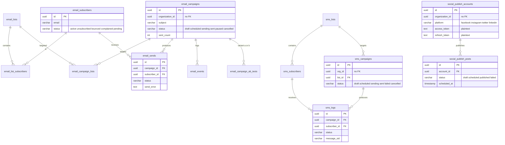
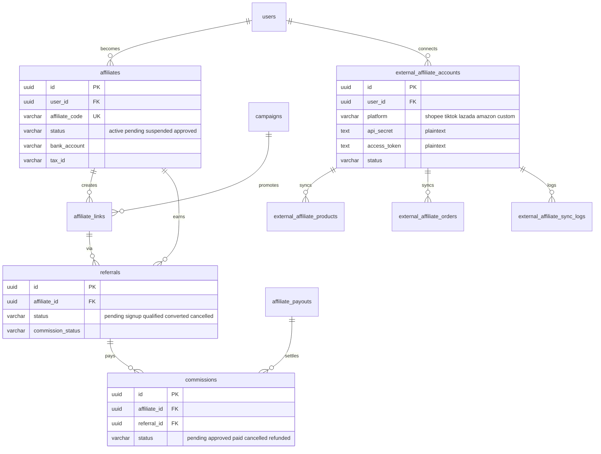

# 09 — ERD

Schema หลักคือ `api-go/migrations/001..016_*.up.sql` (ADR-0002) รวมราว 140 ตาราง ภาพด้านล่างวาดเฉพาะตารางที่ repository/service ใน `api-go` อ่านหรือเขียน แสดงเฉพาะ field สำคัญ (key, status, FK) ตารางที่ไม่มีโค้ดใช้แสดงเป็นรายการท้ายไฟล์
หมายเหตุสำคัญ: คอลัมน์ `organization_id` / `org_id` ในตาราง feature ส่วนใหญ่ **ไม่มี FK** ไป `organizations` (มี FK เฉพาะ `organization_members` และ `campaigns.organization_id` จาก 016)

## Identity และ tenancy

Sources: `api-go/migrations/001_init.up.sql`, `005_organizations.up.sql`, `006_billing.up.sql` (`fk_organizations_plan_id`), `008_fix_users_full_name.up.sql`, `009_refresh_tokens.up.sql`, `010_password_reset_email_verification.up.sql`, `api-go/internal/infrastructure/repository/auth_repository.go`, `user_repository.go`

## Campaigns, A/B, approvals, budget, calendar, PPC

Sources: `api-go/migrations/001_init.up.sql`, `012_phase1_unified_campaigns.up.sql`, `013_ppc_ads.up.sql`, `016_campaigns_organization_id.up.sql`, `api-go/internal/infrastructure/repository/campaign_repository.go`, `abtest_repository.go`, `unified_campaign_repository.go`, `approval_repository.go`, `budget_repository.go`, `calendar_repository.go`, `ads_repository.go`

ชื่อตาราง `unified_campaignes` (สะกดแบบนี้จริงทั้งใน migration และ SQL ของ repository)

## Email, SMS, social

Sources: `api-go/migrations/004_marketing_features.up.sql`, `011_social_media_publishing.up.sql`, `014_sms_marketing.up.sql`, `015_email_complete.up.sql`, `api-go/internal/application/service/email_campaign_service.go`, `marketing_features_service.go`, `social_publishing_service.go`, `api-go/internal/infrastructure/repository/sms_repository.go`

## Affiliates และ external affiliate integrations

Sources: `api-go/migrations/002_affiliate.up.sql`, `003_external_affiliate.up.sql`, `api-go/internal/infrastructure/repository/affiliate_repository.go`, `affiliate_link_repository.go`, `referral_repository.go`, `commission_repository.go`, `external_affiliate_*_repository.go`

## ตารางที่มีใน migration แต่ไม่พบโค้ด Go/Python อ่านหรือเขียน

| Migration | ตาราง |
|---|---|
| `001_init` | `seo_metrics`, `keyword_rankings`, `analytics_events` (Python model มีแค่ `users`, `campaigns`, `ab_tests`, `competitors`) |
| `004_marketing_features` | templates, landing page components/forms/A-B, automation steps/contacts/events/goals, contact tags, influencer profiles/collaborations/content/payments, custom reports/widgets/dashboards, attribution |
| `005_organizations` | `team_invitations`, `roles`, `api_keys`, `organization_settings`, `audit_logs` |
| `006_billing` | 13 ตาราง (`subscription_plans` … `billing_webhook_events`) ไม่มี billing code |
| `007_crm` | 15 ตาราง (`contacts`, `deals`, `pipelines`, `tasks`, `notes` …) ไม่มี CRM handler |

ข้อมูลส่วนบุคคลที่ถูกเก็บ: email/ชื่อ/เบอร์โทรของ subscriber, IP และ user agent (`email_events`, `referrals`), ข้อมูลธนาคารและ `tax_id` ของ affiliate, OAuth/API secrets ของ provider (plaintext `TEXT`, ไม่พบโค้ด encrypt)

## Open questions

- Schema ใดเป็น source of truth ระหว่าง `api-go/migrations`, `docker/migrations`, `api-python/migrations` (ADR-0002)
- ตาราง billing/CRM ที่ไม่มีโค้ดควรเก็บไว้หรือย้ายไป spec อนาคต
- ต้องการเข้ารหัส `access_token`, `api_secret`, `bank_account` at rest หรือไม่
