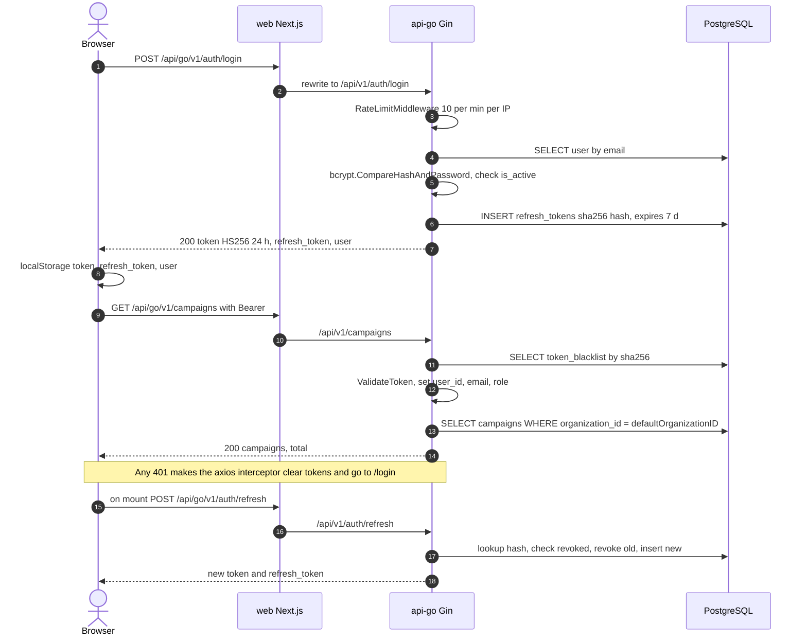
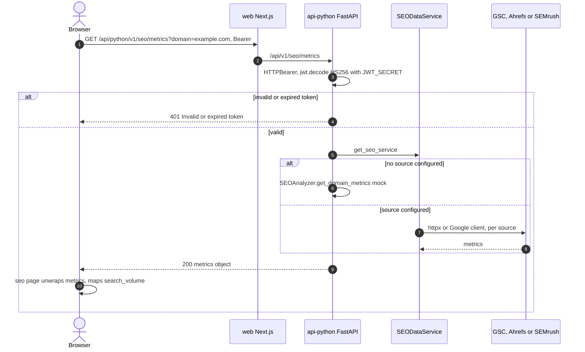
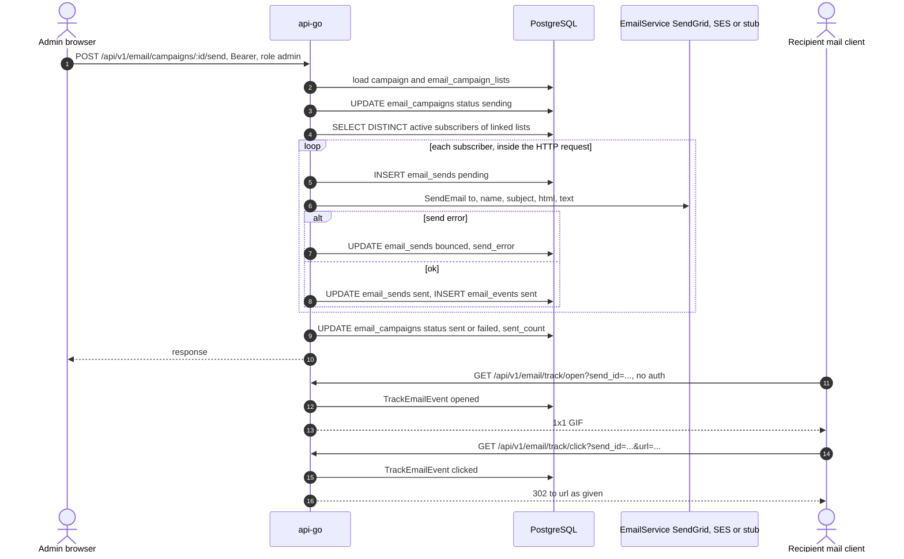
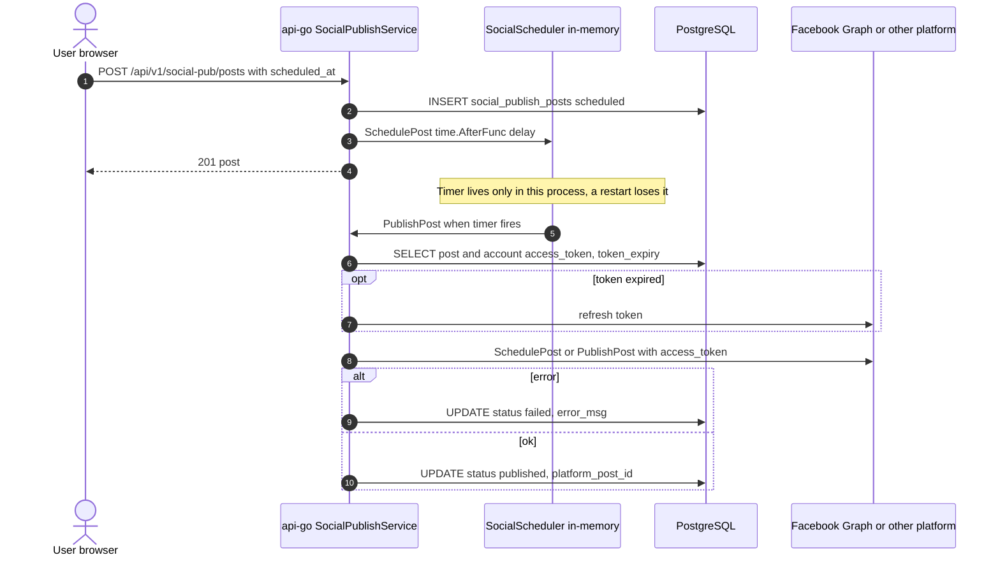

# 10 — Sequences

สี่ request path ที่สำคัญที่สุด: login + เรียก API ที่ต้อง auth, SEO metrics ข้าม service, ส่ง email campaign + tracking และ social post แบบตั้งเวลา

## 1. Login แล้วเรียก API ที่ต้อง auth (และ refresh)

Sources: `web/src/lib/api-client.ts`, `web/src/hooks/useAuth.tsx`, `web/next.config.ts`, `api-go/internal/delivery/http/router.go`, `middleware.go`, `rate_limiter.go`, `auth_handler.go`, `campaign_handler.go`, `api-go/internal/application/service/auth_service.go`, `api-go/internal/infrastructure/repository/auth_repository.go`

## 2. SEO metrics (web → api-python → provider หรือ mock)

Sources: `web/src/app/(dashboard)/seo/page.tsx`, `web/src/lib/api-client.ts` (`seoApi`), `api-python/app/main.py`, `api-python/app/core/auth.py`, `api-python/app/api/seo.py`, `api-python/app/services/seo_data_sources.py`, `api-python/app/services/seo_analyzer.py`

## 3. Admin ส่ง email campaign แล้วผู้รับเปิดและคลิก

Sources: `api-go/internal/delivery/http/router.go` (`email` admin group, `emailTrack` public group), `api-go/internal/delivery/http/email_campaign_handler.go`, `api-go/internal/application/service/email_campaign_service.go`, `api-go/internal/application/service/email_factory.go`, `sendgrid_email_service.go`, `ses_email_service.go`

ข้อสังเกต: `email_campaigns.status` CHECK ใน `004_marketing_features.up.sql` ไม่มีค่า `failed` แต่ service เขียน `failed`; การ UPDATE นั้นจะถูก constraint ปฏิเสธ (อ่านจาก SQL ยังไม่ได้รันยืนยัน) ส่วนการ insert `email_sends` ที่ซ้ำจะถูก `continue` ข้ามเงียบ ๆ

## 4. Social post แบบตั้งเวลา (in-memory timer)

Sources: `api-go/internal/delivery/http/router.go` (`/social-pub` only when `FACEBOOK_APP_ID` set), `api-go/internal/delivery/http/social_handler.go`, `api-go/internal/application/service/social_publishing_service.go`, `api-go/internal/application/service/social_scheduler.go`, `facebook_client.go`

## Open questions

- การส่ง email/SMS ทำ synchronous ใน request เดียว (SMS ดึงสูงสุด 10,000 subscribers): ต้องการ queue/worker หรือไม่
- Scheduled social posts ต้องอยู่รอดข้าม restart หรือไม่ (ตอนนี้ไม่มี job ที่อ่าน `scheduled_at` จาก DB ตอน start)
