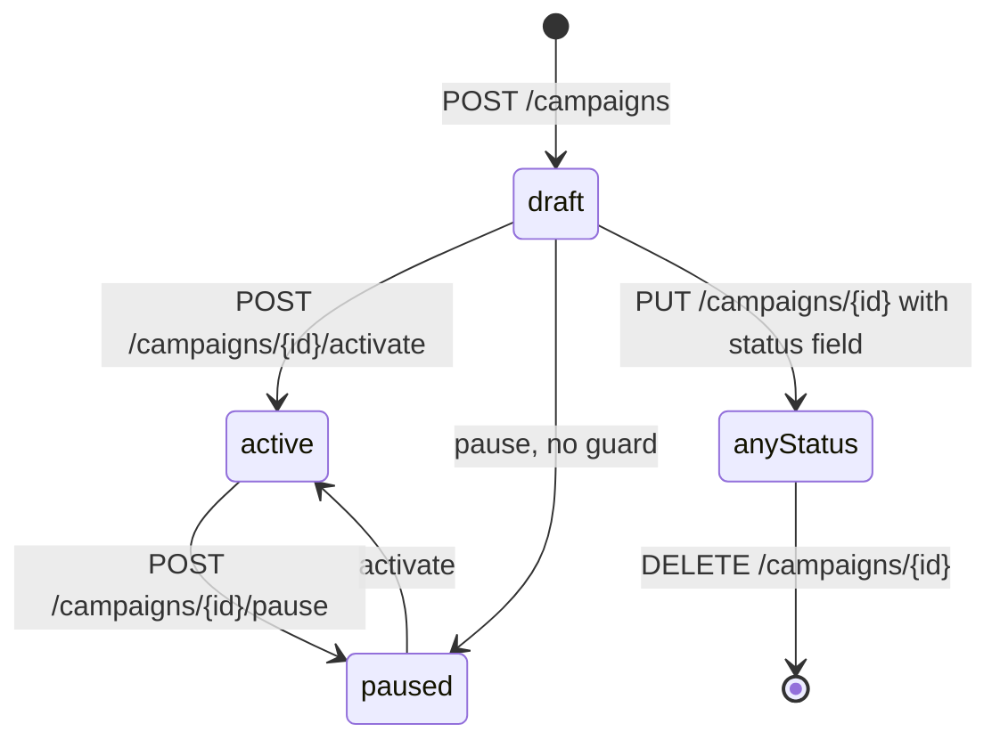
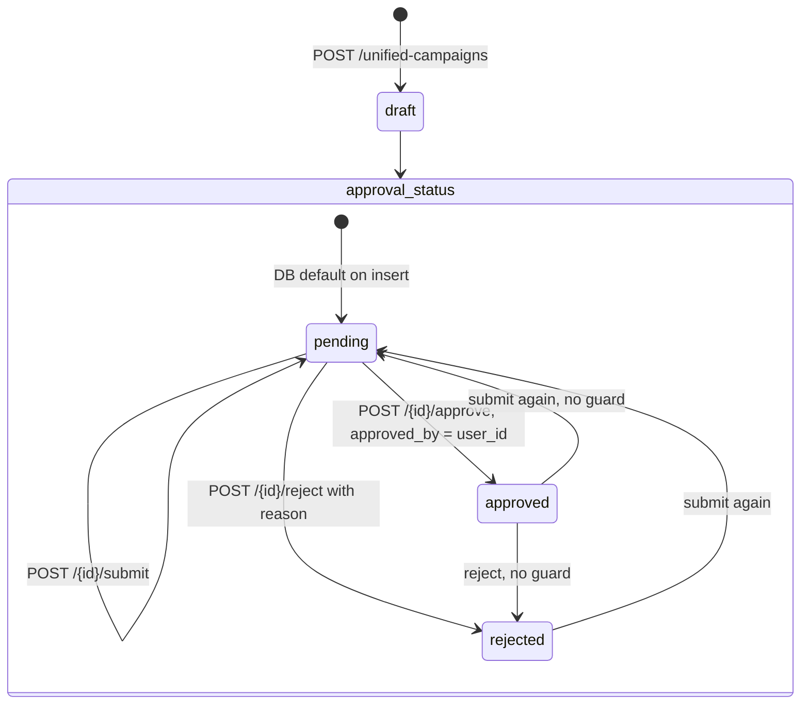
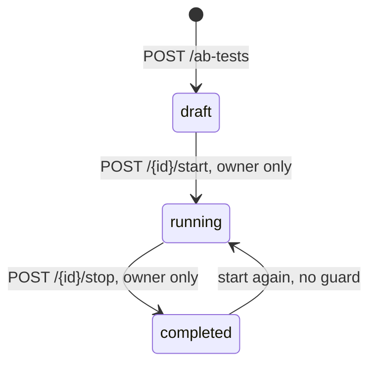
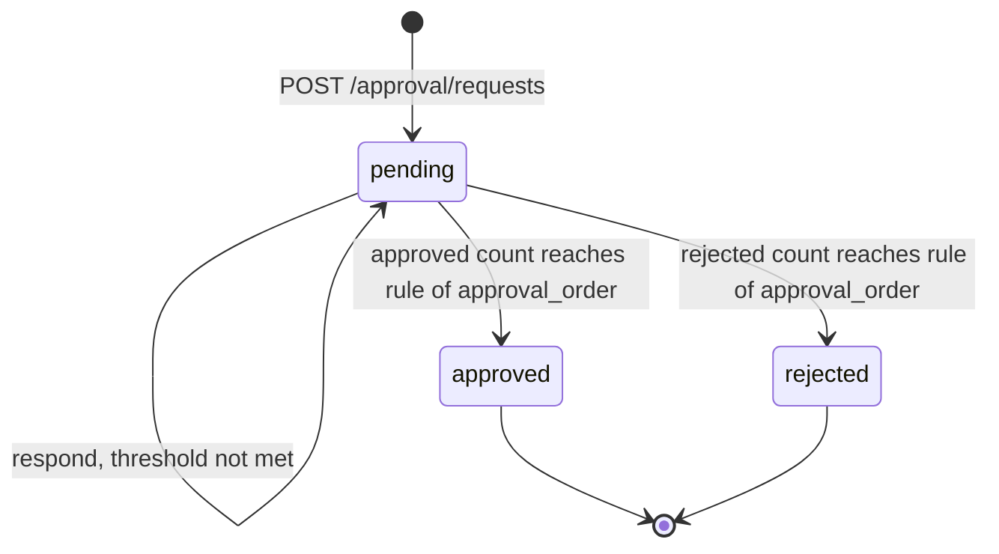
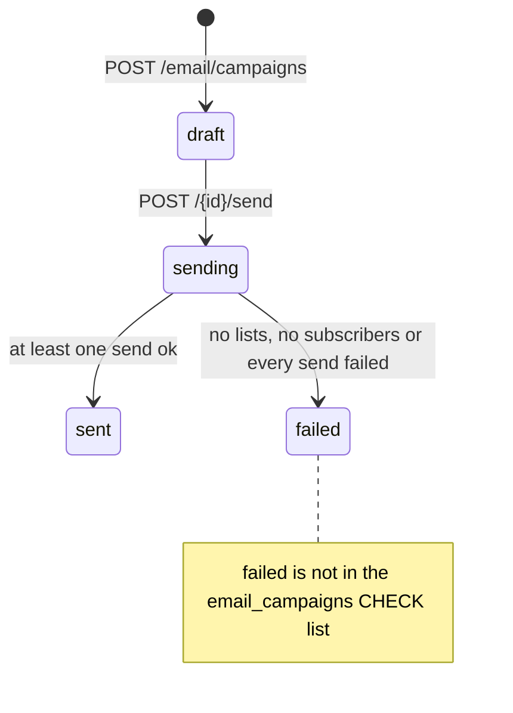
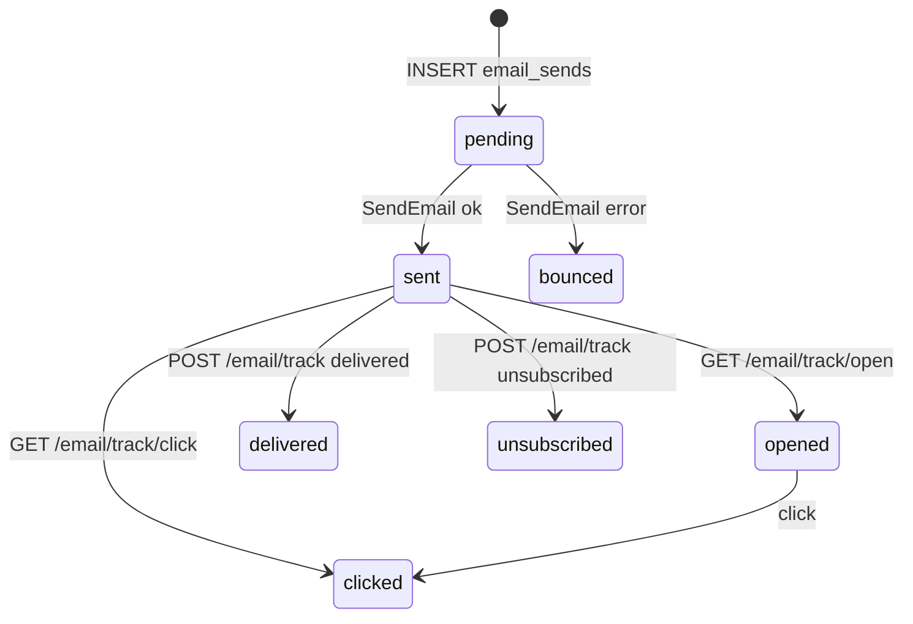
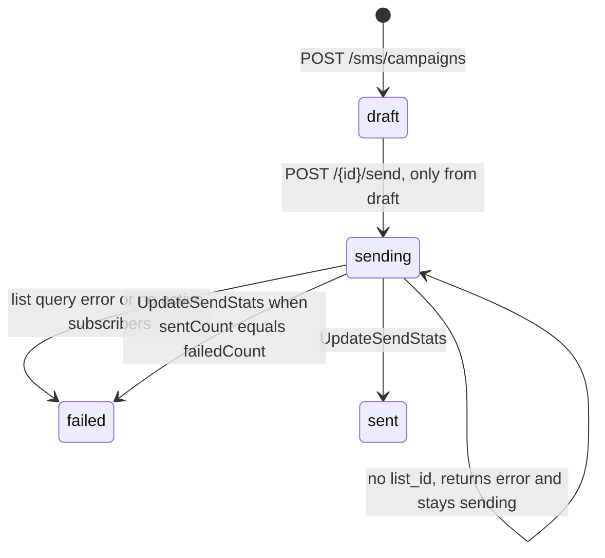
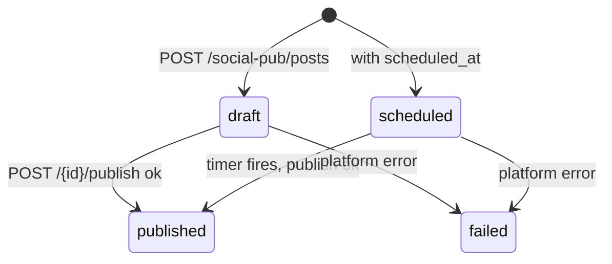
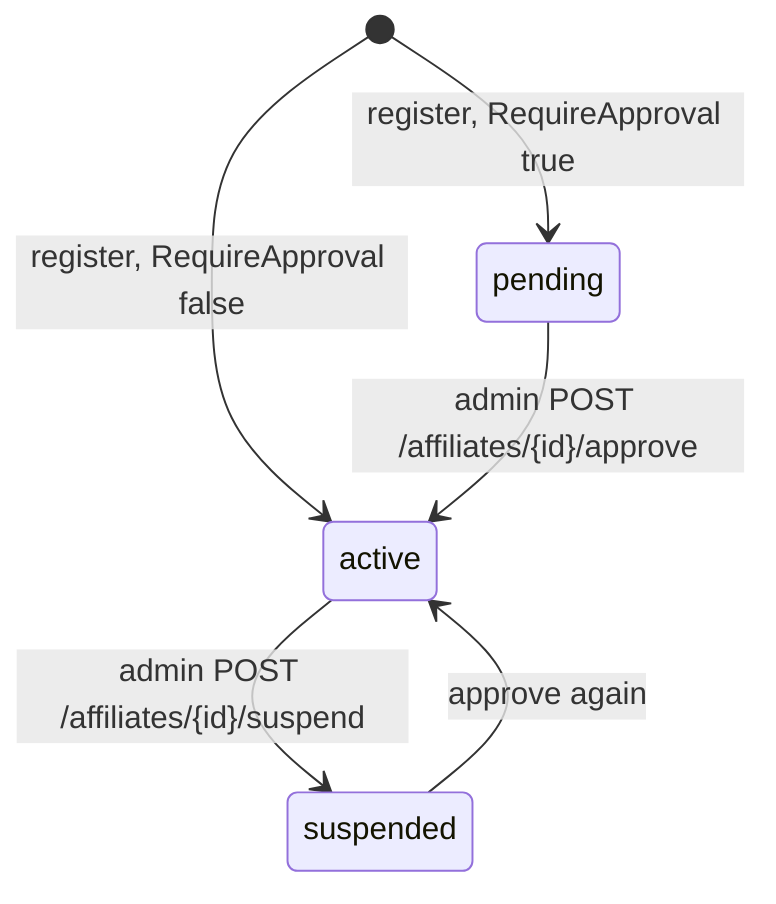

# 11 — State machines

วาดเฉพาะ transition ที่โค้ดเขียนจริง (ไม่ใช่ทุกค่าใน CHECK constraint) ค่าที่มีใน CHECK แต่ไม่มีโค้ดเขียนระบุไว้ใต้ภาพ

## Classic campaign (`campaigns.status`)

Sources: `api-go/internal/delivery/http/campaign_handler.go`, `api-go/internal/application/service/campaign_service.go`, `api-go/migrations/001_init.up.sql` (CHECK `active, paused, completed, draft`)

ไม่มี guard: `PauseCampaign` / `ActivateCampaign` set ค่าทับโดยไม่ดูสถานะเดิม และ `PUT` รับ `status` ใดก็ได้ (DB CHECK เป็นตัวกันสุดท้าย) `completed` ไม่มีโค้ดเขียน

## Unified campaign (`status` + `approval_status`)

Sources: `api-go/internal/delivery/http/unified_campaign_handler.go`, `api-go/internal/infrastructure/repository/unified_campaign_repository.go` (`Create` ไม่ใส่ `approval_status`, `SubmitForApproval`, `Approve`, `Reject`), `api-go/migrations/012_phase1_unified_campaigns.up.sql` (`approval_status DEFAULT 'pending'`)

`status` อื่น (`planning, scheduled, active, paused, completed, cancelled`) เปลี่ยนได้ผ่าน `PUT` เท่านั้น; `not_required` และ `revisions_requested` ไม่มีโค้ดเขียน; SQL ของ submit/approve/reject ไม่มี `WHERE approval_status = ...` จึงไม่มี guard
ในทางปฏิบัติ `POST /unified-campaigns` ส่ง `organization_id = ""` (JWT ไม่มี org) ซึ่ง cast เป็น UUID ไม่ได้: insert จะ error ก่อนเข้า state machine นี้ (`PRODUCT.md` §Trust boundaries, README §api-go)

## A/B test (`ab_tests.status`)

Sources: `api-go/internal/delivery/http/abtest_handler.go` (`StartABTest`, `StopABTest`, user_id check), `api-go/migrations/001_init.up.sql`

## Approval request (`approval_requests.status`)

Sources: `api-go/internal/application/service/approval_service.go` (`Respond`: `any` = 1 approval or 1 rejection; `sequential` = `min_approvers` approvals or 1 rejection; `parallel` / empty = `min_approvers` either way), `api-go/migrations/012_phase1_unified_campaigns.up.sql`

`cancelled`, `expired` ไม่มีโค้ดเขียน; `auto_approve_after_hours` ไม่มีโค้ดอ่าน; respond ซ้ำโดย approver เดิมถูกปฏิเสธ

## Email campaign และ email send

Sources: `api-go/internal/application/service/email_campaign_service.go` (`SendCampaignEmail`, `TrackEmailEvent`), `api-go/migrations/004_marketing_features.up.sql`, `015_email_complete.up.sql`

`TrackEmailEvent` อัปเดต `status` ตาม event โดยไม่ดูลำดับ (เช่น clicked แล้ว open ทีหลังจะกลับเป็น opened)

## SMS campaign (`sms_campaigns.status`)

Sources: `api-go/internal/application/service/sms_service.go`, `api-go/internal/infrastructure/repository/sms_repository.go` (`UpdateStatus`, `UpdateSendStats`), `api-go/migrations/014_sms_marketing.up.sql`

ข้อสังเกต: เช็ก `ListID == nil` หลัง set `sending` แล้ว จึงค้างที่ `sending`; เงื่อนไข `failed` ใน `UpdateSendStats` ใช้ `sentCount == failedCount` ซึ่ง service นับแยกกัน (สำเร็จทั้งหมดหรือล้มทั้งหมดอาจได้ผลไม่ตรงความหมาย)

## Social publish post และ affiliate

Sources: `api-go/internal/application/service/social_publishing_service.go`, `social_scheduler.go`, `api-go/migrations/011_social_media_publishing.up.sql`, `api-go/internal/application/service/affiliate_service.go` (`RegisterAffiliate`, `ApproveAffiliate`, `SuspendAffiliate`), `api-go/migrations/002_affiliate.up.sql`

ค่า `approved` ของ `affiliates.status` ไม่มีโค้ดเขียน (approve set เป็น `active`)

## Open questions

- ต้องการ guard ของ transition (เช่น pause ได้เฉพาะ active, approve ได้เฉพาะ pending) หรือไม่
- ต้องเพิ่ม `failed` ใน CHECK ของ `email_campaigns` หรือเปลี่ยนโค้ดให้ใช้ค่าที่มีอยู่
