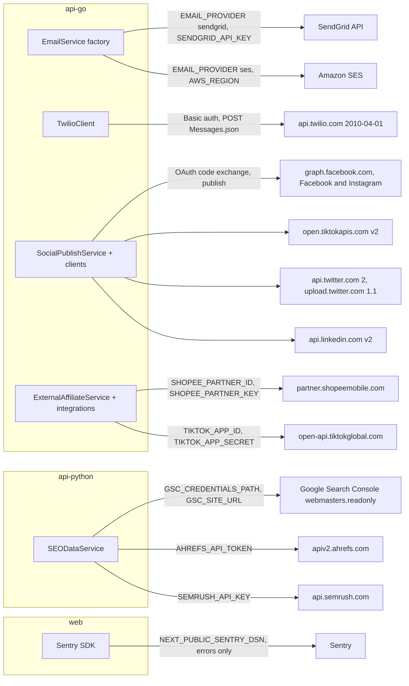
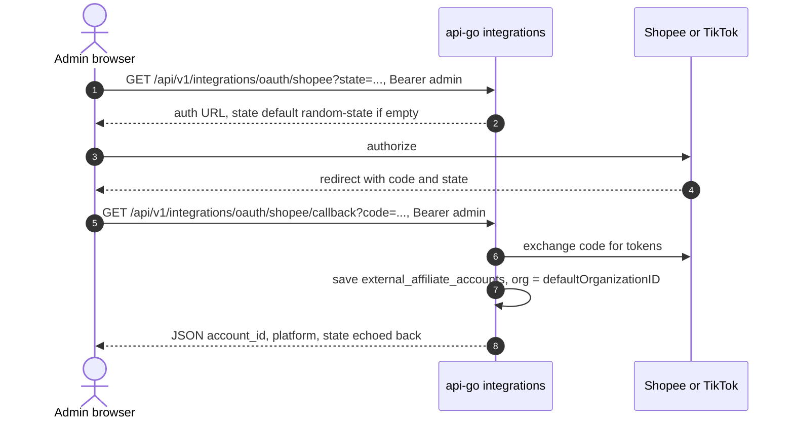

# 12 — API และ integrations

## Endpoint map

Base path ของ Go คือ `/api/v1` (ผ่าน web เป็น `/api/go/v1/...`) และของ Python คือ `/api/v1` (ผ่าน web เป็น `/api/python/v1/...`) ตาม `web/next.config.ts`

| Service | Group | Auth | Endpoints |
|---|---|---|---|
| api-go | `/health` | none | `GET` |
| api-go | `/auth` | none, rate limit 10/min/IP | `POST register, login, refresh, forgot-password, reset-password, verify-email` |
| api-go | `/auth` | JWT | `GET me`, `POST logout, resend-verification` |
| api-go | `/dashboard` | JWT | `GET` |
| api-go | `/campaigns` | JWT | `GET`, `GET /:id`, `POST`, `PUT /:id`, `DELETE /:id`, `POST /:id/pause`, `POST /:id/activate` |
| api-go | `/unified-campaigns` | JWT | CRUD + `POST /:id/submit, /:id/approve, /:id/reject` |
| api-go | `/ab-tests` | JWT | CRUD + `POST /:id/start, /:id/stop` |
| api-go | `/affiliates` | JWT | `POST register`, `GET me, dashboard, stats, links, commissions`, `POST links`, `DELETE links/:id` |
| api-go | `/affiliates` | JWT + admin | `GET`, `GET /:id`, `PUT /:id`, `POST /:id/approve, /:id/suspend`, `GET/PUT settings` |
| api-go | `/affiliates/track` | none | `POST click, signup, conversion` |
| api-go | `/integrations` | JWT + admin | `POST connect`, `GET accounts`, `GET accounts/:id`, `POST accounts/:id/disconnect, sync, link`, `GET accounts/:id/products, orders, logs`, `GET dashboard`, `GET oauth/:platform`, `GET oauth/:platform/callback` |
| api-go | `/email` | JWT + admin | `GET/POST lists, subscribers, campaigns`, `POST campaigns/:id/send`, `GET campaigns/:id/analytics`, `GET/POST ab-tests`, `POST ab-tests/:id/complete`, `POST track` |
| api-go | `/email/track` | none | `GET open`, `GET click` |
| api-go | `/social` | JWT | `GET/POST posts`, `POST posts/:id/schedule` |
| api-go | `/social-pub` | JWT, only if `FACEBOOK_APP_ID` set | `GET oauth/:platform`, `POST connect`, `GET accounts`, `POST accounts/:id/disconnect`, `GET posts, posts/scheduled`, `POST posts, posts/:id/publish`, `DELETE posts/:id`, `GET posts/:id/analytics` |
| api-go | `/landing-pages`, `/automation`, `/influencers`, `/reporting` | JWT | list/create, `POST landing-pages/:id/leads`, `POST influencers/campaigns`, `GET reporting/overview`, `POST reporting/events` |
| api-go | `/budget`, `/calendar`, `/approval` | JWT | periods, allocations, transactions, alerts; events, views; workflows, requests, `POST requests/:id/respond` |
| api-go | `/ads` | JWT + admin | `POST platforms/connect`, `GET platforms`, `GET/POST campaigns`, `GET campaigns/:id`, `POST campaigns/:id/sync, pause, activate` |
| api-go | `/sms` | JWT + admin | `GET/POST lists, subscribers, campaigns`, `POST campaigns/:id/send` |
| api-go gRPC | `:GRPC_PORT` (default 9090) | none, insecure, reflection | `CampaignService` 7 RPC, `AnalyticsService` 3 RPC, `ABTestService` Unimplemented |
| api-python | `/health`, `/` | none | status, name and docs link (`/docs` Swagger default ของ FastAPI) |
| api-python | `/api/v1/competitors` | JWT | list, get, create, update, delete, `/{id}/analyze`, `/market/overview` |
| api-python | `/api/v1/seo` | JWT | `sources, metrics, keywords, backlinks, rankings, audit, competitors/compare`, `POST track` |
| api-python | `/api/v1/analytics` | JWT | `summary, trends, channels, conversion/funnel, attribution, roi`, `POST predict` |
| api-python | `/api/v1/grpc` | JWT | `status`, `POST campaigns/sync`, `analytics/stream`, `campaigns/{id}`, `competitors/{id}` |
| web | `/api/health` | none | `{status, service, commit}` จาก `VERCEL_GIT_COMMIT_SHA` |

Sources: `api-go/internal/delivery/http/router.go`, `api-go/internal/delivery/grpc/server.go`, `packages/grpc-protos/marketing.proto`, `api-python/app/main.py`, `api-python/app/api/*.py`, `web/src/app/api/health/route.ts`, `web/next.config.ts`

## External integrations

Sources: `api-go/internal/application/service/email_factory.go`, `sendgrid_email_service.go`, `ses_email_service.go`, `twilio_service.go`, `facebook_client.go`, `instagram_client.go`, `tiktok_client.go`, `twitter_client.go`, `linkedin_client.go`, `shopee_integration.go`, `tiktok_integration.go`, `api-python/app/services/seo_data_sources.py`, `web/src/lib/sentry.ts`

ไม่มี inbound webhook จาก provider ใด (ไม่มี Twilio status callback, SendGrid event webhook หรือ billing webhook handler แม้มีตาราง `billing_webhook_events`) SMS นับ `delivered` ทันทีที่ส่งสำเร็จ (คอมเมนต์ใน `sms_service.go`: "in production, handle webhook callbacks")

## OAuth connect flow (external affiliate)

Sources: `api-go/internal/delivery/http/external_affiliate_handler.go` (`GetOAuthURL`, `HandleOAuthCallback`), `api-go/internal/application/service/external_affiliate_service.go`, `shopee_integration.go`, `tiktok_integration.go`

ข้อสังเกต: `state` ไม่ถูกตรวจ (แค่ echo กลับ) และ callback อยู่ใต้ admin JWT: redirect ตรงจาก provider ไม่มี `Authorization` header จึงต้องมีหน้า frontend รับ code แล้วเรียกต่อ ซึ่งไม่พบใน `web/src`

## Open questions

- ต้องการ webhook ขาเข้า (Twilio delivery, SendGrid events) หรือไม่
- Callback URL ของ provider จะชี้ไปที่ web route ใด (ตอนนี้ X/LinkedIn hard-code `http://localhost:3000/settings/social/callback`)
- ควรปิด gRPC reflection และเพิ่ม auth บน gRPC เมื่อ deploy หรือไม่
