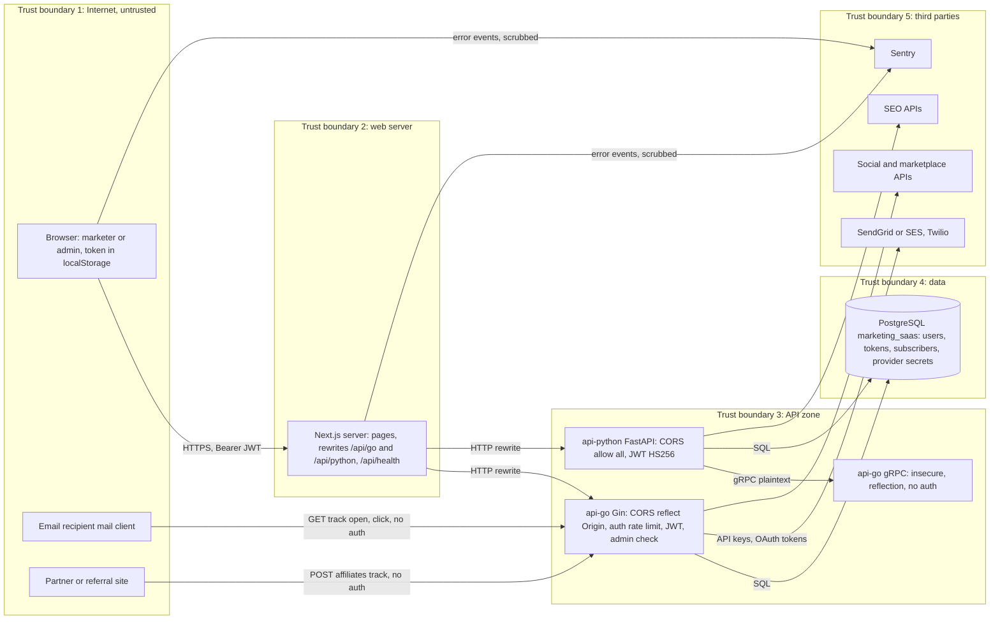

# 13 — Threat model

ขอบเขต: โค้ดตามที่จะรันเมื่อ deploy (ตอนนี้ไม่มี environment จริง ความเสี่ยงจึงยังไม่ "live") อ้างอิง trust boundary ของ `PRODUCT.md` §Trust boundaries

## DFD

Sources: `web/next.config.ts`, `web/src/lib/api-client.ts`, `web/src/hooks/useAuth.tsx`, `web/src/lib/sentry.ts`, `api-go/internal/delivery/http/router.go`, `middleware.go`, `rate_limiter.go`, `api-go/internal/delivery/grpc/server.go`, `api-python/app/main.py`, `api-python/app/core/auth.py`, `api-python/app/api/grpc_client.py`, `api-go/migrations/*.sql`

## STRIDE ต่อ element

| Element | Threat (STRIDE) | Mitigation ที่พบในโค้ด | Gap |
|---|---|---|---|
| Browser session | **S** token theft ผ่าน XSS | React escape โดย default; Sentry ตัด request/user/breadcrumbs | token อยู่ใน `localStorage`; ไม่มี CSP หรือ security headers ใน `next.config.ts`; ไม่มี `middleware.ts` |
| `/auth/*` | **S** brute force, **D** flood | `RateLimitMiddleware` 10/นาที/IP; bcrypt; login error เดียวกันทั้ง user ไม่มีและรหัสผิด; forgot-password ตอบ 200 เสมอ | limiter อยู่ใน memory ต่อ process; key = `c.ClientIP()` และไม่พบ `SetTrustedProxies` (Gin default เชื่อ `X-Forwarded-For` จากทุก proxy) |
| JWT (Go) | **S** forged token | HS256 + `JWT_SECRET`; expiry 24 h; blacklist ตอน logout | default secret `your-secret-key-change-in-production` ถ้าไม่ตั้ง env; ไม่จำกัด alg ด้วย `WithValidMethods`; compose ตั้ง `JWT_SECRET: your-production-secret-change-me` |
| JWT (Python) | **S** | PyJWT `algorithms=["HS256"]`, test 7 cases (`test_auth.py`) | default `JWT_SECRET` hard-coded ใน `config.py` (SPEC-001 §5) |
| Tenancy | **I** / **E** อ่านหรือแก้ข้อมูลของ org อื่น | `AdminOnlyMiddleware` บน email/sms/ads/integrations; A/B test เช็ก owner `user_id` | ไม่มี `organization_id` ใน JWT; classic campaigns ใช้ demo org ร่วมกัน; `GET/PUT/DELETE /campaigns/:id` ไม่เช็ก owner/org; competitors ไม่ scope ตาม user |
| Unified campaign approval | **E** | ต้อง login | ทุก user approve/reject ได้ ไม่มี role/approver check |
| Approval respond | **E** / **R** | กัน approver ตอบซ้ำ | ไม่เช็กว่า approver อยู่ใน `approval_steps` |
| `/email/track/click` | **T** open redirect | — | redirect ไป `url` ใด ๆ ที่ส่งมา (phishing via trusted domain) |
| `/email/track/open`, `/affiliates/track/*` | **T** / **R** ปลอม event | ต้องรู้ `send_id` (UUID) หรือ code | ไม่มี signature หรือ rate limit; IP/UA ถูกเก็บ |
| CORS | **I** cross-site read | proxy ทำให้ไม่จำเป็นต้องใช้ CORS | Go reflect `Origin` ใดก็ได้ + `Allow-Credentials: true`; Python `allow_origins=["*"]` (Bearer header ไม่ใช่ cookie จึงจำกัดผลกระทบ) |
| gRPC | **S** / **I** / **T** | — | plaintext, ไม่มี auth, reflection เปิด, เปิด port ใน compose (`9091:9091`) |
| Error responses | **I** | — | handler หลายตัวตอบ `err.Error()` ตรง ๆ (เช่น SQL error) |
| Logs | **I** | — | `StubEmailService` (default เมื่อไม่ตั้ง `EMAIL_PROVIDER`) log reset/verify URL ที่มี token เต็ม (`email_service.go`) |
| PostgreSQL | **I** secret at rest | password เป็น bcrypt, refresh token เป็น sha256 | provider tokens (`access_token`, `api_secret`), ข้อมูลธนาคาร/`tax_id` เป็น plaintext; reset/verify token เก็บแบบ plaintext; compose ใช้ `postgres/postgres` |
| Seeded admin | **S** / **E** | demo creds ถูกเอาออกจาก login UI (`92e0cf8`, test `no-demo-credentials.test.ts`) | `001_init.up.sql` ยัง seed `admin@marketing.com` พร้อมคอมเมนต์ว่า password `admin123` |
| Sentry | **I** PII leak | `scrubEvent` allowlist, `sendDefaultPii: false`, no tracing/replay (test `sentry.test.ts`) | ครอบคลุมเฉพาะ web; Go/Python ไม่มี error reporting |
| Supply chain / CI | **T** | actions pin SHA; `security.yml` gitleaks, semgrep, osv-scanner, trivy-fs; scanner exceptions มีวันหมดอายุ | `actions/checkout@v4`, `actions/setup-go@v5` ใน job Go ใช้ tag ไม่ใช่ SHA; ไม่มี branch protection |
| Containers | **E** | Go และ web run as non-root; Python `USER appuser` | Go runtime `alpine:latest` ไม่ pin |

Sources: ตามตาราง + `api-go/internal/delivery/http/campaign_handler.go`, `unified_campaign_handler.go`, `email_campaign_handler.go`, `affiliate_handler.go`, `api-go/internal/application/service/approval_service.go`, `auth_service.go`, `api-go/migrations/001_init.up.sql`, `003_external_affiliate.up.sql`, `011_social_media_publishing.up.sql`, `docker/docker-compose.yml`, `api-go/Dockerfile`, `web/Dockerfile`, `api-python/Dockerfile`, `api-python/app/services/competitor_service.py`, `.github/workflows/ci.yml`, `web/tests/no-demo-credentials.test.ts`, `web/tests/sentry.test.ts`

## Open questions

- ต้องปิดหรือ rotate seed admin ก่อน deploy อย่างไร (migration ใหม่, หรือ env-based bootstrap)
- จะใช้ httpOnly cookie แทน `localStorage` หรือไม่
- ต้องการให้ Go/Python มี error reporting (Sentry) ด้วยหรือไม่
