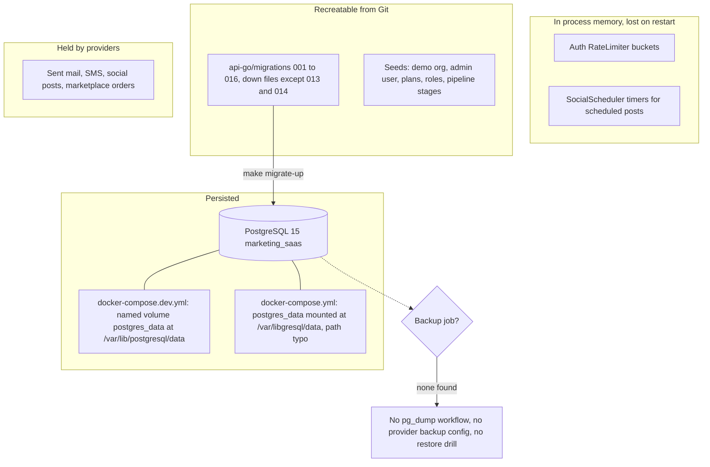

# 14 — Backup และ DR

ไม่มี production environment จึงยังไม่มีข้อมูลจริงให้ backup ภาพนี้คือ "ข้อมูลอยู่ที่ไหนเมื่อรันตาม config ใน repo" และสิ่งที่ยังขาด

Sources: `docker/docker-compose.yml`, `docker/docker-compose.dev.yml`, `api-go/Makefile` (`migrate-up`, `migrate-down`), `api-go/migrations/`, `api-go/internal/delivery/http/rate_limiter.go`, `api-go/internal/application/service/social_scheduler.go`, `.github/workflows/` (มีแค่ `ci.yml`, `deploy-smoke.yml`), `RUNBOOK.md` §Rollback

| Data | ที่อยู่ | Backup | Restore |
|---|---|---|---|
| Users, tokens, campaigns, subscribers, affiliates, provider credentials | PostgreSQL | **ไม่มี** | migrations สร้าง schema ใหม่ได้ ข้อมูลหายถ้าไม่มี dump |
| Rate limit buckets, scheduled-post timers | memory ของ `api-go` | n/a | scheduled posts ที่ค้างจะไม่ถูกตั้งเวลาใหม่หลัง restart (ไม่มีโค้ด reload จาก `scheduled_at`) |
| Schema + seed | Git | Git | `make migrate-up`; ย้อนด้วย `make migrate-down` (013, 014 ไม่มี down) |
| Code / images | Git | Git | RUNBOOK §Rollback: "Redeploy previous container image / previous git tag" (repo ไม่มี tag) |

- **RTO / RPO:** not defined (ไม่มีใน `RUNBOOK.md`, `PRODUCT.md`, `docs/measurement/KPI-PLAN.md`)
- `docker/docker-compose.yml` mount volume ไปที่ `/var/libgresql/data` (สะกดผิด) ขณะที่ PGDATA ของ image คือ `/var/lib/postgresql/data`: ข้อมูลจะไม่อยู่ใน named volume `postgres_data` (อ่านจาก config ยังไม่ได้รันยืนยัน)

## Open questions

- เมื่อ deploy จะใช้ DB ที่ไหน (Neon ตาม pattern ของ service อื่น?) และจะใช้ provider backup/PITR หรือ backup job ของตัวเอง
- RTO/RPO เป้าหมาย
- Scheduled social posts ควร persist และ reload ตอน start หรือไม่
