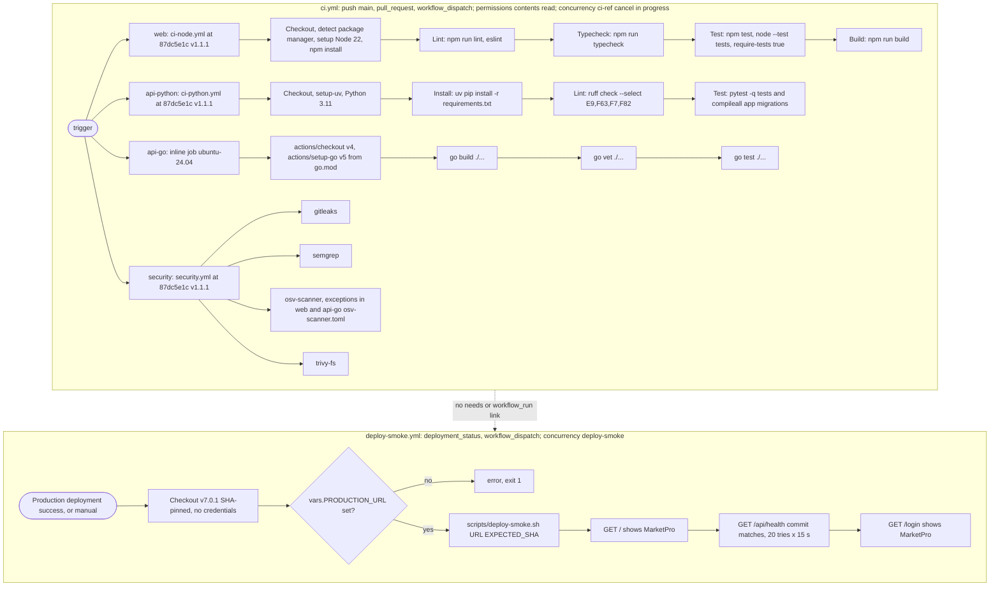

# 15 — CI/CD pipeline

สอง workflow ใน `.github/workflows/`: `ci.yml` (build/test/security, "CI never deploys") และ `deploy-smoke.yml` (ตรวจหลัง deploy ซึ่งยังไม่เคยเกิด)

Sources: `.github/workflows/ci.yml`, `.github/workflows/deploy-smoke.yml`, `scripts/deploy-smoke.sh`, `web/package.json` (scripts), `api-go/go.mod`, `api-python/requirements.txt`, `web/osv-scanner.toml`, `api-go/osv-scanner.toml`, platform-ci-workflows `87dc5e1c` `.github/workflows/ci-node.yml` (step names, `lint/typecheck/test-command: auto`), `ci-python.yml`, `security.yml` (job names)

ข้อเท็จจริงจาก `gh run list` (2026-11-03): CI รัน 8 ครั้ง ทั้งหมดเป็น `push` บน `main` (ไม่มี PR run); ล้ม 1 ครั้งที่ `1095ae3` (jobs `api-go`, `web`, `security / osv-scanner` fail) แก้ใน `c796b31` ภายใน ~14 นาที; `Deploy smoke` ไม่เคยรัน; GitHub deployments ของ repo = 0

## Open questions

- จะ deploy ไปที่ไหน (deploy-smoke เขียนรอ Vercel `deployment_status`) และ api-go / api-python จะไป host ใด
- ต้องการ pin `actions/checkout@v4` / `actions/setup-go@v5` ใน job Go เป็น SHA ให้ตรงกับ policy ของ shared workflows หรือไม่
- เปิด coverage gate (`coverage-threshold`) ของ shared workflows หรือไม่ (ตอนนี้ไม่ได้ส่ง input)
