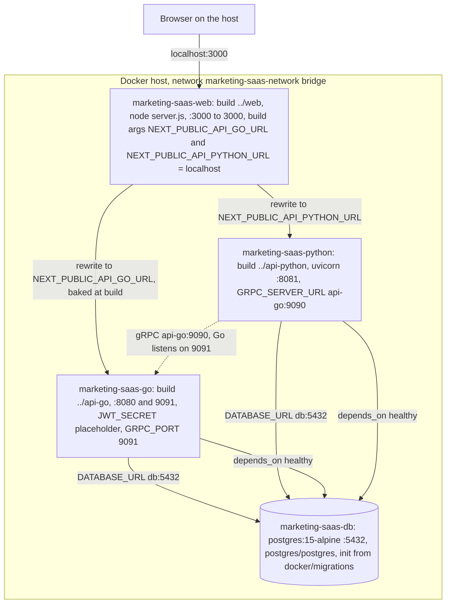
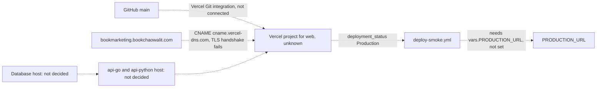

# 16 — Deployment

**สถานะจริง (2026-11-03): ไม่มี deployment.** GitHub deployments ของ repo = 0, `Deploy smoke` ไม่เคยรัน, `deploy-smoke.yml` ระบุ "This repository has no production host yet" และ SPEC-001 §5 "No deployment" config เดียวที่บอก topology ได้คือ `docker/docker-compose.yml`

## Topology ตาม `docker/docker-compose.yml` (local / self-host)

Sources: `docker/docker-compose.yml`, `docker/docker-compose.dev.yml`, `web/Dockerfile`, `api-go/Dockerfile`, `api-python/Dockerfile`, `web/next.config.ts`, `api-go/cmd/main.go`

ข้อสังเกต: rewrites ของ web อ่าน `NEXT_PUBLIC_API_GO_URL` ซึ่ง compose ส่งเป็น `http://localhost:8080` ตอน build; ภายใน container `localhost` คือ container web เอง (env `API_GO_URL: http://api-go:8080` ใน compose ไม่มีโค้ดอ่าน) ดังนั้น proxy ใน compose น่าจะต่อ API ไม่ได้ (อ่านจาก config ยังไม่ได้รันยืนยัน)

## เป้าหมายที่โค้ดเตรียมไว้ (ยังไม่ได้ตั้ง)

Sources: `.github/workflows/deploy-smoke.yml`, `scripts/deploy-smoke.sh`, `web/src/app/api/health/route.ts` (`VERCEL_GIT_COMMIT_SHA`), `specs/001-next16-ci-sentry/spec.md` §5, `gh api repos/.../deployments` (0), `getent hosts bookmarketing.bookchaowalit.com` + `curl https://bookmarketing.bookchaowalit.com/` (2026-11-03: resolves to Vercel, curl error 35 TLS)

SPEC-001 (2026-10-22) บันทึกว่า `bookmarketing.bookchaowalit.com` ไม่ resolve; วันที่ทำ pack นี้ DNS ชี้ Vercel แล้วแต่ไม่มี certificate/project ตอบ และ `marketing.bookchaowalit.com` เป็นของ repo `marketing-bookmarketing-web` (Vercel project `bookchaowalit-bookmarketing-frontend`)

## Open questions

- ใครเพิ่ม DNS `bookmarketing` → Vercel และผูกกับ Vercel project ใด
- host ของ api-go / api-python / PostgreSQL เมื่อ deploy (Railway? Neon?) และ env ชุดไหน
- จะเลิกใช้ `NEXT_PUBLIC_*` สำหรับ rewrites ฝั่ง server แล้วใช้ env runtime แทนหรือไม่
