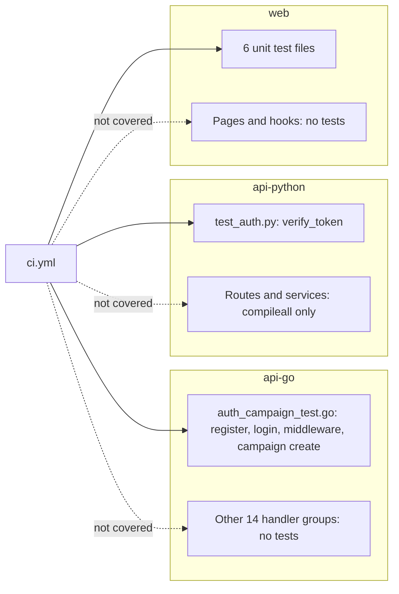

# 17 — Test coverage matrix

Test files ที่มีจริง: `api-go/internal/delivery/http/auth_campaign_test.go` (7 top-level tests, 15 subtests ตาม README), `api-python/tests/test_auth.py` (7 cases), `web/tests/*.test.ts` (6 ไฟล์, `node --test`) ไม่มี E2E test ใน repo และ CI ไม่ได้วัด coverage (ไม่ส่ง `coverage-threshold`)

ระดับ: **unit** = ฟังก์ชันเดี่ยว; **integration** = `httptest` ผ่าน Gin router + service จริง + repository in-memory; **e2e** = browser หรือ stack จริง

| Feature | Unit | Integration | E2E | Test file |
|---|---|---|---|---|
| Register (hash, token, persist, duplicate, invalid input, repo error) | — | ✅ | ❌ | `auth_campaign_test.go` |
| Login (ok, wrong password, inactive, invalid input) | — | ✅ | ❌ | `auth_campaign_test.go` |
| AuthMiddleware (missing / tampered token) | — | ✅ | ❌ | `auth_campaign_test.go` |
| Classic campaign create (ok, invalid, unauthenticated, storage error) | — | ✅ | ❌ | `auth_campaign_test.go` |
| Classic campaign get / update / delete / pause / activate | ❌ | ❌ | ❌ | gap |
| Refresh, logout, blacklist, forgot / reset password, verify email | ❌ | ❌ | ❌ | gap |
| Rate limiter `/auth` | ❌ | ❌ | ❌ | gap |
| Admin-only routes (`AdminOnlyMiddleware`) | ❌ | ❌ | ❌ | gap |
| Unified campaigns + submit / approve / reject | ❌ | ❌ | ❌ | gap |
| A/B tests, budget, calendar, approval workflow `Respond` | ❌ | ❌ | ❌ | gap |
| Email campaign send + tracking, SMS send, social publish, affiliates, external integrations, PPC | ❌ | ❌ | ❌ | gap |
| gRPC server | ❌ | ❌ | ❌ | gap |
| SQL repositories against PostgreSQL / migrations apply | ❌ | ❌ | ❌ | gap (README: ยืนยันด้วยมือบน DB ทิ้งได้ 2026-08) |
| Python JWT verify (valid, wrong secret, expired, HS384/HS512, unsigned, garbage) | ✅ | — | ❌ | `api-python/tests/test_auth.py` |
| Python SEO / competitors / analytics routes | ❌ | ❌ | ❌ | gap (CI รัน `compileall` เท่านั้น) |
| Web `next.config` (no webpack hook, no ignoreBuildErrors, proxies) | ✅ | — | — | `web/tests/next-config.test.ts` |
| Web CSV export (RFC 4180, formula injection) | ✅ | — | — | `web/tests/csv.test.ts` |
| Web Sentry options + `scrubEvent` | ✅ | — | — | `web/tests/sentry.test.ts` |
| Web `paletteColor` | ✅ | — | — | `web/tests/palette.test.ts` |
| Web `/api/health` build marker | ✅ | — | ❌ | `web/tests/health.test.ts`; deploy-smoke ไม่เคยรัน |
| No demo credentials in `login/page.tsx`, `public/index.html` | ✅ (static source check) | — | — | `web/tests/no-demo-credentials.test.ts` |
| Hydration of `/login`, `/signup` (AC-05) | — | — | ⚠️ manual | Playwright 24 loads ใน SPEC-001, ไม่มีไฟล์ |
| Dashboard pages, `useAuth`, API client paths | ❌ | ❌ | ❌ | gap (จะจับ path `/api/api/v1` ใน 03 ได้) |
| Web build | — | ✅ `npm run build` ใน CI | — | `ci.yml` |

Sources: `api-go/internal/delivery/http/auth_campaign_test.go`, `api-python/tests/test_auth.py`, `web/tests/*.test.ts`, `web/package.json` (`test`), `.github/workflows/ci.yml`, `README.md` §Go HTTP tests, `specs/001-next16-ci-sentry/spec.md` §3

## Open questions

- ลำดับความสำคัญของ test ถัดไป (PRODUCT Next improvement 2: auth + campaigns + SEO unwrap)
- ต้องการ integration test กับ PostgreSQL จริง (shared workflow มี input `postgres`) เพื่อยืนยัน migrations ใน CI หรือไม่
