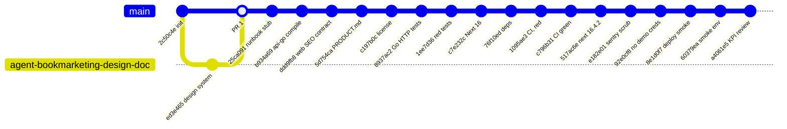
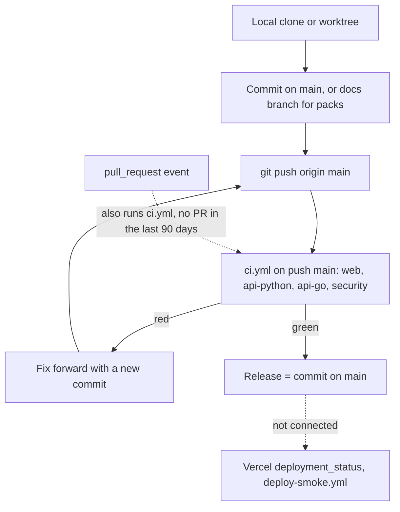

# 18 — Git และ release workflow

ข้อมูลจาก `git log` บน `origin/main` (20 commits ตั้งแต่ `2c50c4e` 2026-04-12) และ `gh pr list` (PR เดียว #1 merged 2026-07-26)
ไม่มี tag, ไม่มี release, ไม่มี branch protection (`gh api .../branches/main/protection` → 404) และไม่มี deployment: "release" ของ repo นี้คือ commit บน `main` ที่ CI เขียว

หมายเหตุ: `git log` ปัจจุบันเป็นเส้นตรง (ไม่มี merge commit) จึงแสดง PR #1 ตาม `gh pr list` ไม่ใช่ตาม topology ของ git

Sources: `git log --format="%h %ad %s"`, `gh pr list --state all`, `gh run list` (8 runs, all `push` on `main`), `gh api repos/bookchaowalit-website/marketing-campaign-platform/branches/main/protection`, `.github/workflows/ci.yml`, `.github/workflows/deploy-smoke.yml`, `PRODUCT.md` §Dirty-tree triage, `DIRTY-TRIAGE.md`

แนวปฏิบัติที่เห็นจาก history: conventional commits (`feat`, `fix`, `test`, `ci`, `docs`, `chore`), TDD "red" commit ก่อน fix (`1ee7d36` → `c7e232c`, `34a136f` → `e182e01`) ตาม ADR-0004 ของ architecture-docs และ commit แยก cluster ตาม `DIRTY-TRIAGE.md`

## Open questions

- ต้องการ branch protection / required checks บน `main` หรือไม่
- เมื่อมี deployment จะ tag release หรือใช้ commit SHA จาก `/api/health` อย่างเดียว
