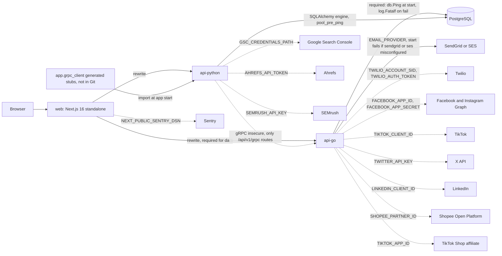

# 19 — Service dependency map

Runtime dependencies ตามโค้ด เส้นทึบ = จำเป็นต่อการ start หรือ flow หลัก; เส้นประ = optional (เปิดด้วย env, ADR-0005)

Sources: `web/next.config.ts`, `web/src/lib/sentry.ts`, `api-go/cmd/main.go`, `api-go/internal/infrastructure/database/postgres.go`, `api-go/internal/delivery/http/router.go`, `api-go/internal/application/service/email_factory.go`, `twilio_service.go`, `api-python/app/core/database.py`, `api-python/app/api/grpc_client.py`, `api-python/app/services/seo_data_sources.py`, `.gitignore`

## Libraries หลักต่อ service

| Service | Direct dependencies (ไฟล์) |
|---|---|
| web | next ^16.4.2, react 19.2, @mui/material 5, @emotion, @tanstack/react-query 5, axios ^1.20, recharts 3, @sentry/nextjs ^11.8 (`web/package.json`) |
| api-go | gin 1.10.0, golang-jwt/jwt v5.3.1, lib/pq 1.10.9, grpc 1.83.2, protobuf 1.36.11, aws-sdk-go 1.50.0 (SES), sendgrid-go 3.14.0, x/crypto 0.58.0 (bcrypt), google/uuid, godotenv (`api-go/go.mod`) |
| api-python | fastapi 0.157.0, uvicorn 0.54.0, sqlalchemy 2.0.25, psycopg2-binary, alembic, PyJWT 2.15.1, grpcio 1.84.0, httpx 0.28.1, pandas, scikit-learn, numpy 1.26.4, sendgrid, boto3, google-api-python-client (`api-python/requirements.in`) |
| shared | `@bookmarketing/shared-types` (`packages/shared/types.ts`), `packages/grpc-protos/marketing.proto` |

ไม่มี CDN, cache (Redis), queue หรือ object storage ในโค้ด

## Open questions

- `api-python` ประกาศ `sendgrid` และ `boto3` ใน `requirements.in` แต่ไม่พบโค้ดส่ง email ฝั่ง Python ที่ถูก route ใช้ (`app/services/email_service.py` มีอยู่): ยังต้องใช้หรือไม่
