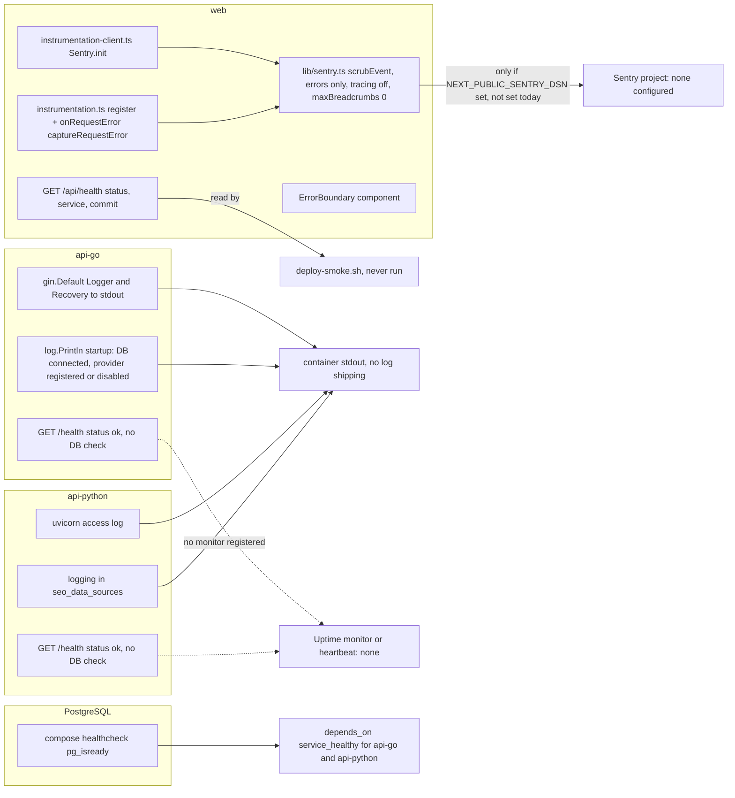

# 20 — Observability

**Reused:** แผน KPI และ instrumentation อยู่ใน [`docs/measurement/KPI-PLAN.md`](../measurement/KPI-PLAN.md) (status draft; review 2026-10-24 "changes requested": KPI-G-01 ไม่มี session source, KPI-L-02 ไม่ระบุ module tables) ไฟล์นี้วาด signal ที่ instrument จริงในโค้ดวันนี้

Sources: `web/src/instrumentation.ts`, `web/src/instrumentation-client.ts`, `web/src/lib/sentry.ts`, `web/tests/sentry.test.ts`, `web/src/app/api/health/route.ts`, `web/src/components/ErrorBoundary.tsx`, `api-go/internal/delivery/http/router.go` (`gin.Default()`, `/health`), `api-go/cmd/main.go`, `api-python/app/main.py`, `api-python/app/services/seo_data_sources.py`, `docker/docker-compose.yml`, `scripts/deploy-smoke.sh`, `docs/measurement/KPI-PLAN.md`

| Signal | What is watched | Status |
|---|---|---|
| Sentry (web, browser + Node + Edge) | unhandled errors, `onRequestError` | code merged; DSN ไม่ได้ตั้ง (KPI-PLAN "DSN not set") → disabled |
| Sentry (api-go, api-python) | — | ไม่มี SDK |
| `/api/health` (web) | commit SHA ที่ deploy | ใช้โดย deploy-smoke เท่านั้น ยังไม่เคยรัน |
| `/health` (Go, Python) | process ตอบได้ | ไม่ตรวจ DB; ไม่มี monitor |
| Logs | Gin access log, startup log, uvicorn | stdout เท่านั้น ไม่มี structured log หรือ log drain (`LOG_LEVEL` ใน compose ไม่มีโค้ดอ่าน) |
| Business KPIs (KPI-O-01, L-01, L-02) | SQL บน `campaigns`, `users` | blocked by deployment (KPI-PLAN) |
| Analytics endpoints (`/api/v1/analytics/*`) | — | คืนค่า `random` ไม่ใช่ข้อมูลจริง: อย่าใช้เป็น metric |
| Product analytics (PostHog ฯลฯ) | — | ไม่มีในโค้ด |

## Open questions

- Sentry project/DSN สำหรับ web (และจะเพิ่ม Go/Python หรือไม่)
- จะลงทะเบียน uptime monitor / heartbeat เมื่อมี URL หรือไม่ และ `/health` ควรตรวจ DB ด้วยหรือไม่
- แก้ประเด็น review ของ KPI-PLAN (session source ของ KPI-G-01)
