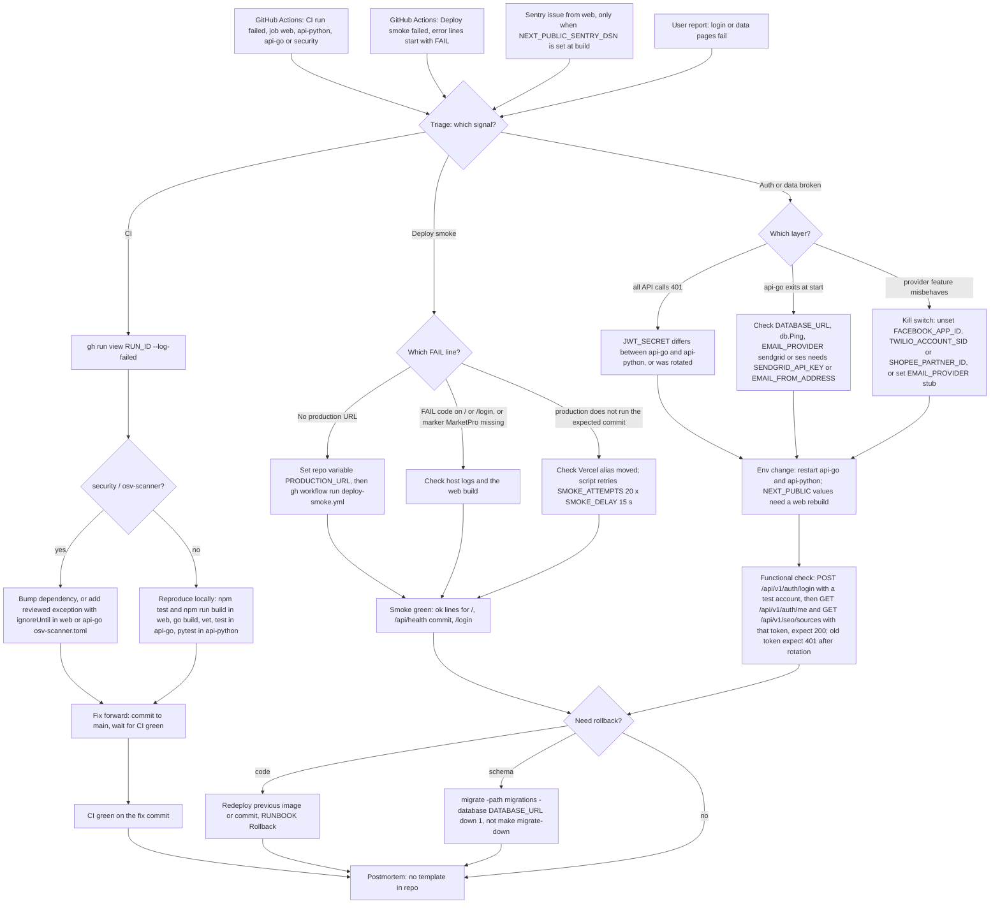

# 21 — Incident response

Solo operator ไม่มี on-call หลายคน (`RUNBOOK.md` §Owner) ไม่มี production จึงยัง **ไม่มี alert channel ที่ live**: สัญญาณที่มีจริงคือ GitHub Actions run ที่ fail (`ci.yml`, `deploy-smoke.yml`) และ Sentry ของ web เมื่อมีการตั้ง `NEXT_PUBLIC_SENTRY_DSN` ไม่พบ template postmortem หรือ incident log ใน repo
ขั้นตอนด้านล่างอ้างชื่อ job, step, env และคำสั่งตามที่อยู่ในโค้ด และแยกให้ชัดว่าการเปลี่ยน env ต้อง restart/redeploy แล้วตรวจแบบ functional ไม่ใช่แค่ GET `/health`

Sources: `.github/workflows/ci.yml` (job names), `.github/workflows/deploy-smoke.yml` (step "Require a production URL", `vars.PRODUCTION_URL`), `scripts/deploy-smoke.sh` (`HOME_MARKER`, `HEALTH_PATH`, `MAIN_ROUTE`, `SMOKE_ATTEMPTS`, `SMOKE_DELAY`, `::error::FAIL` messages), `web/osv-scanner.toml`, `api-go/osv-scanner.toml`, `web/src/lib/sentry.ts`, `api-go/cmd/main.go`, `api-go/internal/delivery/http/router.go` (env read once in `NewRouter`), `api-go/internal/application/service/email_factory.go`, `twilio_service.go`, `api-python/app/core/config.py`, `api-python/app/core/auth.py`, `api-python/app/api/seo.py` (`/sources`), `api-go/Makefile` (`migrate-up`, `migrate-down`), `RUNBOOK.md` §Rollback, §Owner

รายละเอียดที่ต้องระวัง

- **Env ของ api-go อ่านครั้งเดียวตอน start** (`NewRouter`, `NewEmailService`, `NewTwilioClient`) และ `api-python` อ่าน `Settings()` ตอน import: เปลี่ยน env แล้วต้อง restart/redeploy ทั้ง process
- `NEXT_PUBLIC_API_GO_URL`, `NEXT_PUBLIC_API_PYTHON_URL` (rewrites) และ `NEXT_PUBLIC_SENTRY_DSN` ถูกใช้ตอน build (`web/Dockerfile` build args): ต้อง rebuild web
- `GET /health` ของ Go และ Python ตอบ `ok` โดยไม่แตะ DB หรือ provider: ไม่ใช่หลักฐานว่าแก้สำเร็จ ให้ใช้ functional check ข้างบน และสำหรับ email ให้เรียก `POST /api/v1/auth/forgot-password` กับบัญชีทดสอบแล้วดูว่า provider ได้รับจริง (stub แค่ log)
- Rotate `JWT_SECRET` ต้องตั้ง **ค่าเดียวกัน** ใน api-go และ api-python; token ทั้งหมดใช้ไม่ได้ทันที; refresh token ใน DB ยังอยู่แต่ access token ใหม่จะออกด้วย secret ใหม่
- `make migrate-down` เรียก `migrate ... down` แบบไม่ระบุจำนวนและ hard-code DSN `localhost`: จะย้อน **ทุก** migration บน DB local; ใน incident ให้ใช้ `down 1` กับ `DATABASE_URL` ที่ถูกต้อง และ `013`, `014` ไม่มีไฟล์ down
- Kill switch ของ social publish คือเอา `FACEBOOK_APP_ID`/`FACEBOOK_APP_SECRET` ออกแล้ว restart: route `/api/v1/social-pub/*` จะไม่ถูก register (404) และ timer ของ scheduled posts ที่ค้างอยู่หายไปพร้อม process

## Open questions

- ช่องทาง alert ที่ต้องการเมื่อ deploy (Sentry email, Telegram ตาม pattern ของ repo อื่น?)
- ต้องการบัญชีทดสอบสำหรับ functional check ใน production และ seed admin จะถูกจัดการอย่างไร
- ที่เก็บ postmortem / incident log
