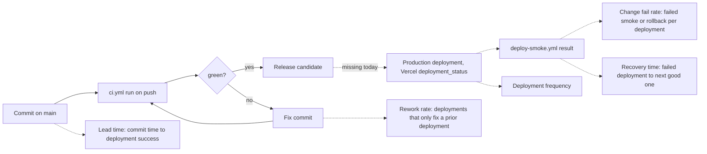

# 22 — DORA

ช่วงวัด: 90 วันย้อนหลังถึง 2026-11-03 (`2026-08-05` → `2026-11-03`) repo นี้ **ไม่มี deployment** (GitHub deployments = 0, ไม่มี deploy workflow, `Deploy smoke` ไม่เคยรัน) ตัวชี้วัด DORA ที่นิยามบน deployment จึงคำนวณค่าจริงไม่ได้ ตารางแสดงวิธีวัดเมื่อมี deployment และค่า proxy จาก CI บน `main` ที่คำนวณได้วันนี้



Sources: `.github/workflows/ci.yml`, `.github/workflows/deploy-smoke.yml`, `git log`, `gh run list`, `gh api repos/bookchaowalit-website/marketing-campaign-platform/deployments`

| Metric | วิธีวัดสำหรับ repo นี้ (เมื่อมี deployment) | ค่า 90 วัน (deployment จริง) | ค่า proxy จาก CI บน `main` |
|---|---|---|---|
| Deployment frequency | จำนวน GitHub deployment `Production…` state `success` / วัน | **0** (ไม่มี deployment) | commits บน `main` = 18 ใน 6 วันที่มี commit; CI push runs = 8 (ตั้งแต่ CI ถูกเพิ่ม 2026-10-21 UTC) |
| Lead time for changes | `deployment.created_at` ของ deploy ที่สำเร็จ − committer date ของ `deployment.sha` | **ไม่สามารถคำนวณ** | commit → CI เสร็จ: median 1.5 นาที, max 13 นาที (8 runs: 1,1,1,1,2,3,5,13) |
| Change fail rate | deployments ที่ deploy-smoke fail หรือถูก rollback / deployments ทั้งหมด | **ไม่สามารถคำนวณ** | CI fail 1 / 8 runs = 12.5% (`1095ae3`) |
| Failed deployment recovery time | เวลาจาก deploy-smoke fail ถึง deploy-smoke success ถัดไป | **ไม่สามารถคำนวณ** | CI red → green: 2026-10-21 17:46:08Z (`1095ae3`) → 17:59:54Z (`c796b31`) = 13 นาที 46 วินาที |
| Deployment rework rate | deployments ที่เป็น fix ของ deployment ก่อนหน้า (unplanned) / deployments ทั้งหมด | **ไม่สามารถคำนวณ** | fix commit ที่ตามหลัง CI แดง 1 (`c796b31`) / 8 runs = 12.5% |

## คำสั่งที่ใช้

```bash
# deployments (ผล: 0)
gh api repos/bookchaowalit-website/marketing-campaign-platform/deployments --jq 'length'

# CI runs + เวลา commit → CI เสร็จ
gh run list -R bookchaowalit-website/marketing-campaign-platform -L 100 \
  --json headSha,conclusion,updatedAt,workflowName \
  --jq '.[] | "\(.headSha) \(.conclusion) \(.updatedAt)"' |
while read sha c u; do ct=$(git show -s --format=%cI "$sha"); \
  echo "${sha:0:7} $c $(( ( $(date -d "$u" +%s) - $(date -d "$ct" +%s) ) / 60 )) min"; done

# commits บน main ในช่วง 90 วัน (ผล: 18)
git log --since=2026-08-05 --until=2026-11-04 --first-parent origin/main --oneline | wc -l

# jobs ของ run ที่ fail
gh run view 39646617426 -R bookchaowalit-website/marketing-campaign-platform --json jobs \
  --jq '.jobs[] | "\(.name) \(.conclusion)"'
```

ข้อจำกัด: proxy วัดคุณภาพของ CI ไม่ใช่ production; ช่วง 90 วันมี CI อยู่แค่ 13 วันสุดท้าย และไม่มี commit บน `main` ตั้งแต่ 2026-10-24

## Open questions

- ควรเริ่มนับ DORA เมื่อ deploy ครั้งแรกและให้ deploy-smoke เป็นตัวตัดสิน change fail หรือไม่
- ถ้า web กับ API deploy แยก host จะนับ deployment ต่อ service หรือรวม
